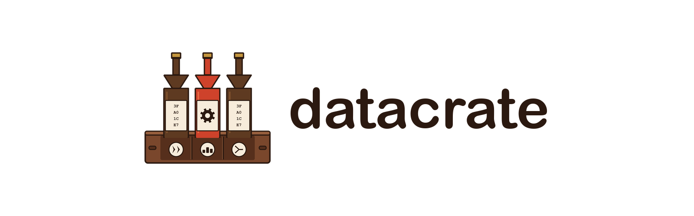
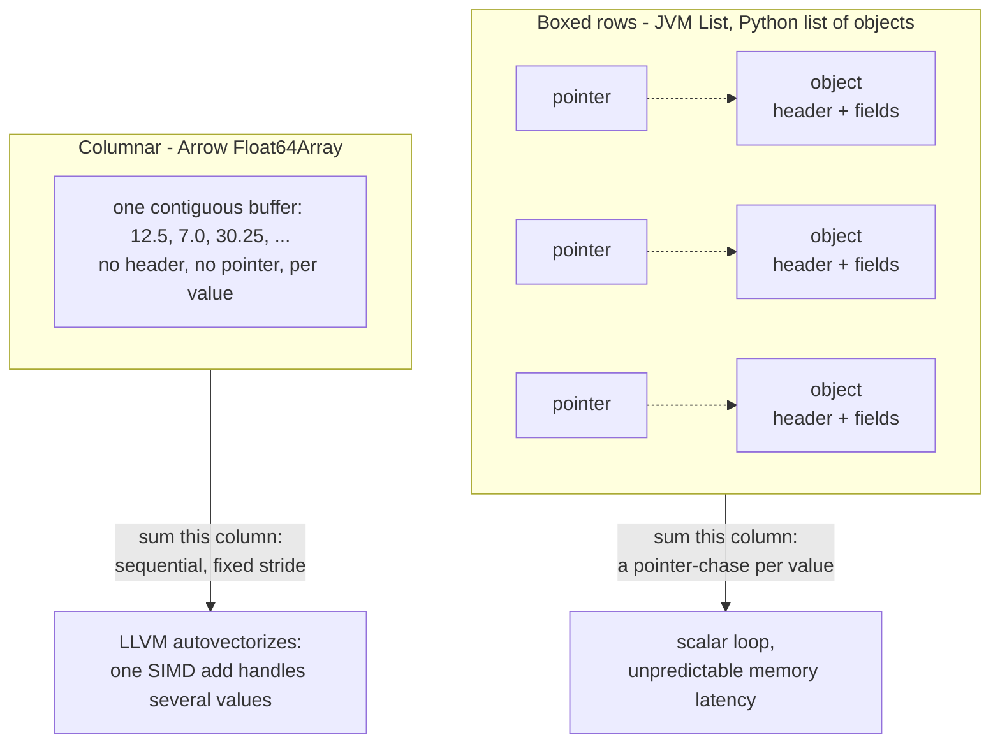
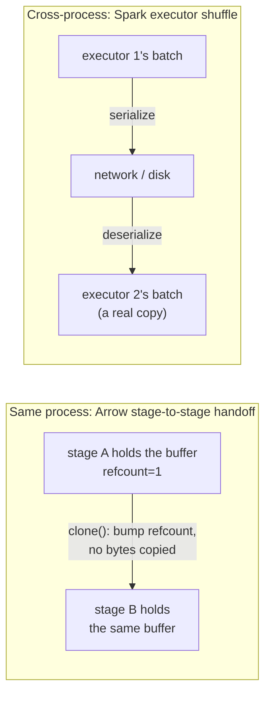

[](https://github.com/com-vitthalmirji/datacrate/actions/workflows/ci.yml)
[](https://github.com/com-vitthalmirji/datacrate/actions/workflows/release-plz.yml)
[](https://github.com/com-vitthalmirji/datacrate/actions/workflows/audit.yml)
[](https://com-vitthalmirji.github.io/datacrate/)
[](https://crates.io/users/vim89)
[](https://www.rust-lang.org)
[](LICENSE)
---

# datacrate

`datacrate` is an end-to-end data-engineering platform in Rust, under active
development. One Cargo workspace brings together streaming CSV/Arrow ingestion,
compile-time schema contracts, typestate pipeline builders, Parquet storage,
DataFusion SQL and DataFrame queries, and cloud object-store I/O. Ballista
composes a scheduler and executor into one typed app, extending query
execution across processes; a separate sbt/Scala project explores native
Comet acceleration inside Spark.

The engineering focus is on explicit pipeline boundaries: compiler-resolved type
shapes and const-evaluated compatibility checks, fallible callbacks with checked
batch output, bounded batch transport with optional byte admission, captured object
identity, and owned output publication with recoverable failure information. The
core pipeline runs natively in Rust; Comet operates within Spark's JVM runtime.

### Where the guarantees apply

- **Contracts** compare Rust declarations when an explicit check or typed
  stage connection is instantiated by `cargo build`. The opt-in Arrow validator
  checks actual batches against supported physical schemas.
- **Typed pipeline** automatically checks every declared source, transform and
  sink connection during a build, then validates source and transform batches
  before downstream callbacks. The existing builders still enforce their own
  stage-presence rules; callback failures remain runtime results.
- **Ingest validation** checks actual callback output against the current fixed
  `id`, `name`, nullable `note` schema before accepting it at the pipeline boundary.

These layers complement each other. External data still needs runtime validation;
memory accounting, schema mappings and publication guarantees have defined scopes
explained in the guide.

See [Getting Started](https://com-vitthalmirji.github.io/datacrate/getting-started.html)
for a walkthrough of the workspace and each chapter.

## Prerequisites

- [rustup](https://rustup.rs/) - the pinned toolchain in `rust-toolchain.toml`
  (stable, with `rustfmt` and `clippy`) is installed automatically on first
  `cargo` invocation in this directory.
- [`just`](https://github.com/casey/just) - task runner used for all dev
  commands below (`cargo install just` or via your package manager).

## Quick start

```sh
git clone <this-repo>
cd datacrate
just verify   # fmt check, clippy (warnings denied), tests, release build
```

Run the CSV column-selection CLI directly:

```sh
cargo run -p csv-select-cli --bin csv-select -- fixtures/m1/headers.csv --column 1
```

## Why Rust/Arrow, mechanistically

Two mechanisms explain almost everything below. Neither is a slogan - both
have a proof point in this repo.

**Mechanism 1: a flat column is one buffer, not many separate objects.**
A JVM `List[Order]` or a Python list of objects is a list of pointers, each
pointing to a separately-allocated object scattered across the heap wherever
the allocator and garbage collector put it. Reading every `order.amount`
means following a different pointer each time - slow mainly because each
jump risks a cache miss, not because addition is slow. Arrow's
`Float64Array` is the opposite: every number sits edge-to-edge in one
contiguous buffer, the same shape as a C `double[]` array. That shape is
what lets the CPU use a SIMD instruction - one instruction that adds several
numbers at once, instead of one instruction per number - because the
compiler can only do that when it can prove the next few numbers sit at a
fixed, predictable distance apart in memory. This isn't assumed: compiling
`crates/pipeline/src/bin/heavily-nested-transpose-cost.rs`'s `leaf_values()`
and reading the generated machine code shows a `fadd.2d` instruction on ARM
NEON - "add two 64-bit floats at once" - sitting where a one-at-a-time loop
would otherwise be. No boxed object graph can offer the compiler that same
proof, no matter how hot the loop runs.



**Mechanism 2: ownership lets two pipeline stages share a buffer instead of
copying it.** Arrow's underlying buffer is wrapped in an `Arc` (atomic
reference count): cloning it doesn't copy the bytes, it bumps a counter and
hands out a second pointer to the *same* memory. Rust trusts a cloned `Arc`
to be safe to read from multiple places, with no garbage collector
double-checking at runtime, because the borrow checker already proved at
compile time that nothing holding a read reference is also mutating the
same data. A Spark shuffle can't use that trick - executors are separate
processes, sometimes separate machines, so a shared pointer is meaningless
once the two sides aren't in the same address space. A `RecordBatch`
crossing that boundary has to be serialized to bytes, sent over the network
or to disk, and deserialized on the other side, even when nobody plans to
change a single value.



**Both mechanisms together turn "touch every row" into "touch one buffer,"
and the gap grows with nesting depth.** Measured, checksum-verified,
reproducible locally (`benchmark/REPORT.md`):

| Benchmark | Columnar (no materialization) | Row round trip | Ratio |
|---|---|---|---|
| `transpose-cost`, 100 flat columns, 500K rows | 32.19ms | 388.36ms | 12.1x |
| `nested-transpose-cost`, `List<Float64>` | 0.18ms | 11.58ms | 64.6x |
| `heavily-nested-transpose-cost`, 5-level nesting | 57.33µs | 7.31ms | 127.5x |

Same algorithm, same language, same safety guarantees - the only variable
is memory-access pattern. `crates/pipeline/src/layout.rs`'s `ColumnarBatch`/
`RowBatch` types make "don't accidentally transpose" a compile error
(`tests/compile_fail/layout_type_mismatch.rs`), not a benchmark hoping it
holds; `zero-transpose-end-to-end` (`benchmark/REPORT.md`) reads Parquet,
filters, and writes Parquet entirely through `&RecordBatch` with
`write_parquet` never calling a row-conversion path.

A deeper walkthrough of both mechanisms - more diagrams, the full nested-type
case - lives in
[the book's scale-and-parity chapter](https://com-vitthalmirji.github.io/datacrate/scale-and-parity.html#why-columnar-layout-wins-no-boxes-no-garbage-collector-one-instruction-for-many-rows).

These numbers are same-process, same-host, checksum-verified comparisons -
not a claim about Spark, Comet, or any other engine's absolute speed. Where
this repo did measure against Spark/Comet/Ballista (`benchmark/REPORT.md`),
every number is labeled with hardware, run count, and whether it's measured
or a projection; none of it implies a general "N times faster than Spark"
claim, because workload, scale, and harness change the ratio - sometimes
sharply (Comet was *slower* than vanilla Spark on this repo's own 5M-row
aggregate and join benchmarks).

### Where this sits in the Rust-on-data ecosystem

`datacrate` doesn't compete to replace Spark's engine - DataFusion, Comet,
Ballista, Polars, and Sail (LakeSail) already occupy that space, each a
different answer to "which engine runs the query." `datacrate` runs on
DataFusion and asks a different question: can a pipeline's stage-to-stage
schema disagreement fail at `cargo build`, before any data moves, instead of
hours into a job? That's the compile-time contract gate below - a layer
*above* the chosen engine, not a new one.

## Demo: a drifted schema fails the build

`schema-gate-example` wires the whole chain together: a Parquet file, a dbt
`schema.yml`, and an Erwin XML export are each parsed by `schema-codegen`
into a struct, and every struct is checked against the pipeline's declared
input model at compile time. Build it once with everything matching:

```sh
cargo build -p schema-gate-example
```

This passes. Now break the dbt schema on purpose - open
`fixtures/schema-gate-example/orders_dbt_schema.yml` and mark
`customer_name` as not null, when the pipeline's input model still declares
it optional:

```yaml
      - name: customer_name
        data_type: varchar(100)
        tests:
          - not_null
```

Build again:

```sh
touch crates/schema-gate-example/build.rs
cargo build -p schema-gate-example
```

The build fails before any pipeline code runs:

```
error[E0080]: evaluation panicked: producer schema does not conform to the contract: mismatch `customer_name` (expected `Optional`, found `String`)
```

Revert the fixture to put it back the way it was:

```sh
git checkout fixtures/schema-gate-example/orders_dbt_schema.yml
```

The same gate runs independently against the Parquet and Erwin sources too -
see [`crates/schema-gate-example/src/lib.rs`](crates/schema-gate-example/src/lib.rs)
and [`crates/schema-gate-example/build.rs`](crates/schema-gate-example/build.rs).

## Demo: one command from a dbt schema to a running S3 pipeline

`scaffold-cli pipeline` renders a complete, compiling `ContractPipeline`
binary from a steward-declared schema - no hand-written struct, no hand-wired
registration or sink code. This generates a pipeline that reads a dbt model
with a nested `customer.address` struct column from one S3/MinIO bucket,
filters and aggregates it, and writes the result to another:

```sh
cargo run -p scaffold-cli -- pipeline \
  --source-schema dbt:fixtures/dbt/orders_schema.yml:orders \
  --target-schema dbt:fixtures/dbt/orders_schema.yml:orders_totals \
  --source-data s3://datacrate-raw/orders.parquet \
  --transform-df "filter:quantity,gt,0" \
  --transform-df "aggregate:group=region;sum(quantity)=total_quantity" \
  --sink-parquet s3://datacrate-curated/orders_totals.parquet \
  --name OrdersPipeline \
  --out crates/typestate/examples/orders_pipeline_demo.rs
```

This is generation, not execution - `scaffold-cli` never opens a connection
to dbt or S3/MinIO itself; it scaffolds code that assumes both exist at the
*generated* pipeline's run time. The source schema can also be `parquet:`,
`erwin:`, or `delta:`; the transform stage can be either a literal SQL
string (`--transform-sql`) or, as above, a chain of named `DataFrame`-API
operations (`select`/`filter`/`aggregate`/`sort`/`limit` via repeated
`--transform-df` flags) - both paths render through `syn`/`quote!` token
trees, so a malformed brace or identifier is impossible by construction, not
just caught by a test. See
[the contracts chapter](https://com-vitthalmirji.github.io/datacrate/contracts.html#one-command-four-external-systems-zero-live-connections)
for the full nested-struct walkthrough.

## Why this matters: a small story from a big data project

In a large company, nobody owns the whole pipeline alone. A few roles matter here:

The data steward or data modeler owns the model of truth. They write it down in dbt
`schema.yml` files and Erwin ER diagrams, and they decide which columns can be empty
and which cannot. Their job is governance, not code. They rarely open the pipeline
repository.

The data engineer owns the pipeline code. They read the steward's model once, write
it into their pipeline as a Rust struct, and build on top of it. They trust that the
model they copied down still matches what the steward has on file.

Time passes. The steward's team tightens a rule, maybe `customer_name` must now
always be filled in, and updates `schema.yml`. Nobody tells the engineer. In most
companies this gap is invisible until a scheduled job fails at 3am, or worse, loads
bad rows silently.

This repo closes that gap at build time instead of at 3am. The engineer's struct and
the steward's file are both inputs to the same compile step. The moment they drift
apart, `cargo build` fails on the engineer's machine, in CI, before a single row of
data moves, with the exact column and the exact mismatch named in the error. The
steward keeps owning the model. The engineer keeps owning the pipeline. The compiler
is what keeps the two sides honest without a meeting, a ticket, or a 3am page.

## Development

| Command        | What it does                                               |
|----------------|------------------------------------------------------------|
| `just fmt`     | `cargo fmt --all --check`                                  |
| `just lint`    | `cargo clippy --all-targets --all-features -- -D warnings` |
| `just test`    | `cargo test --all-targets --all-features --locked`         |
| `just release` | `cargo build --profile ci-release --locked`                           |
| `just verify`  | all of the above, plus `git diff --check`                  |

Run `just verify` before opening a pull request - it is the same check CI runs.

### Git hooks

Enable the repo's pre-commit hook (runs `just verify` before each commit) once per clone:

```sh
git config core.hooksPath .githooks
```

## Workspace layout

```
crates/
├── dtl-core/              lib   - ownership/borrowing/slices fundamentals, zero-copy CSV batching
├── csv-cli/               bin   - streaming CSV column-selection CLI (csv-select)
├── pipeline/              lib   - Arrow/Parquet/DataFusion pipeline, object-store I/O,
│                                  Ballista distribution (BallistaApp), Comet acceleration
├── typestate/             lib   - typestate pipeline builder (source/transform/sink)
├── contracts/             lib   - compile-time schema-conformance checking
├── contracts-derive/      lib   - `#[derive(Contract)]` proc macro backing `contracts`
├── connectors-derive/     lib   - `#[derive(Connector)]`: registers a contract struct's batches
│                                  with DataFusion (memory/Parquet/CSV) and emits typed column
│                                  accessors for filter/sort expressions
├── schema-codegen/        lib   - parses a Parquet file, dbt `schema.yml`, or Erwin XML export
│                                  into a matching `#[derive(Contract, Connector)]` struct
├── scaffold-cli/          bin   - `struct`: seeds one Contract/Connector struct from a Parquet
│                                  file's schema. `pipeline`: renders a complete, compiling
│                                  ContractPipeline binary from a Parquet/dbt/Erwin/Delta source
│                                  (S3/MinIO or local), an optional SQL or DataFrame-API transform,
│                                  and a Parquet (S3/MinIO or local) sink
├── schema-gate-example/   lib   - end-to-end proof that a drifted dbt/Erwin/Parquet schema
│                                  fails `cargo build`, not just a unit test
└── rusty-ready/           lib   - general Rust practice and playground, isolated from the other crates
                                   (exercises/ subdir: workshop compiler-error drills)
fixtures/         deterministic test data, committed
scala/
└── comet-interop/  separate sbt/Scala project (not part of the Cargo workspace) - scaffolds
                     Spark Comet operator-replacement rules from `derives CometOperator`
                     declarations; see scala/comet-interop/README.md
```

See [`CONTRIBUTING.md`](CONTRIBUTING.md) for commit message conventions,
branching, and the pull request process.

## Documentation

- Guide (published): https://com-vitthalmirji.github.io/datacrate/
- API reference (rustdoc, published): https://com-vitthalmirji.github.io/datacrate/api/
- API reference (also on docs.rs): https://docs.rs/dtl-core
- API reference (local): `cargo doc -p dtl-core --open`
- Guide (local): `cargo install mdbook --locked && mdbook serve book`

For the precise boundaries and migration steps, see:

- [Contract checks, Arrow mapping and the 0.2 reference migration](https://com-vitthalmirji.github.io/datacrate/contracts.html)
- [Typed stage contracts, callback errors and fixed-ingest validation](https://com-vitthalmirji.github.io/datacrate/typestate.html)
- [Memory, cancellation and local publication](https://com-vitthalmirji.github.io/datacrate/datafusion.html)
- [Captured object reads and remote publication](https://com-vitthalmirji.github.io/datacrate/object-store.html)
- [Dependency audit policy and recorded exceptions](docs/adr/0009-supply-chain-policy-gate.md)

A green dependency audit reflects the advisory database and configured exceptions
at that run. Dependency fixes must reach `main` before related issues are treated
as resolved there.
