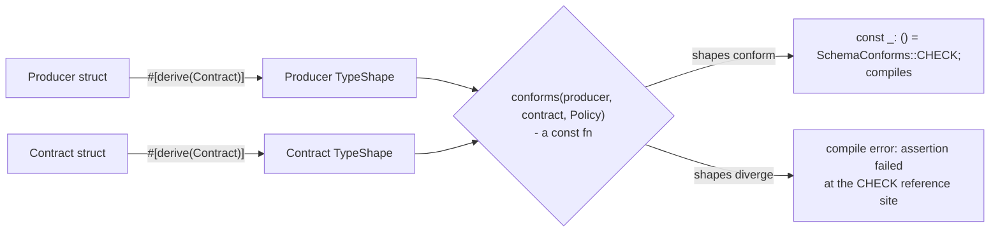
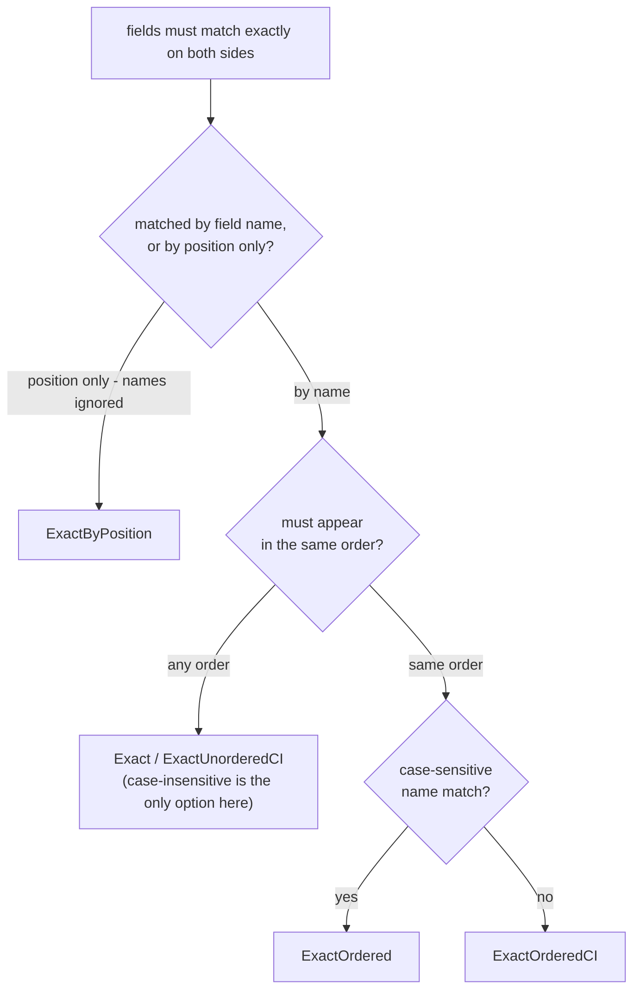

# Compile-time schema contracts

`crates/contracts` (plus its derive macro, `crates/contracts-derive`) checks
whether one struct's shape is compatible with another's - the "producer" and
the "contract" - entirely at compile time. If the shapes don't conform under
the chosen policy, the crate fails to compile with an `assertion failed`
message pointing at the check, not a test failure discovered later.

## The problem this solves

Two parts of a pipeline agree on a schema by convention: a struct produced
by one stage, and a struct expected by the next. Nothing stops them from
drifting apart - a field gets renamed, a type changes from `String` to
`Option<String>` - and the mismatch is usually only caught when real data
flows through and something panics or silently drops a column. This crate
turns that drift into a build failure instead.

## How it works

1. `#[derive(Contract)]` walks a struct's fields and builds a `TypeShape`
   tree describing them - recursing through `Option<T>`, `Vec<T>`, and
   `HashMap`/`BTreeMap<K, V>` so nested optionality is preserved rather than
   flattened (`Vec<Option<T>>` and `Vec<T>` are different shapes, and stay
   different all the way through comparison).
2. `conforms(producer, contract, policy)` is a `const fn` that structurally
   compares two `TypeShape`s under a [`SchemaPolicy`](#policies).
3. `SchemaConforms::<Producer, ContractT, Policy>::CHECK` is a `const` whose
   initializer panics if the shapes don't conform. Referencing it from a
   `const _: () = ...;` item forces the compiler to evaluate that panic
   during compilation - so a schema mismatch becomes a real compile error at
   the reference site.

```rust,ignore
use contracts::{Backward, Contract, SchemaConforms};

#[derive(Contract)]
struct Producer {
    id: i64,
    name: String,
    tags: Vec<Option<String>>,
}

#[derive(Contract)]
struct Target {
    id: i64,
    name: String,
    note: Option<String>, // missing from Producer, but Optional - allowed under Backward
}

// Fails to compile if Producer no longer conforms to Target under Backward:
const _: () = SchemaConforms::<Producer, Target, Backward>::CHECK;
```



The comparison itself is ordinary structural logic; what makes it a contract
is that it runs inside a `const fn` referenced from a `const _: () = ...`
item, forcing the compiler to evaluate - and potentially panic on - it during
compilation, not at any later test run.

## Policies

| Policy | Rule |
|---|---|
| `Exact` | Same fields on both sides, matched by name case-insensitively, in any order, each with an identical shape. No extras either way. |
| `ExactUnorderedCI` | Identical to `Exact` - a distinct name kept for parity with `compile-time-data-contracts`, which exposes both. |
| `ExactOrdered` | Like `Exact`, but fields are matched positionally by index and names compared case-*sensitively*. |
| `ExactOrderedCI` | Like `ExactOrdered`, but names are compared case-insensitively. |
| `ExactByPosition` | Fields matched purely by index; names aren't compared at all, only the shape at each position. |
| `Backward` | Every contract field is satisfied - present (matched by name, case-sensitively) with a matching shape, or absent but `Optional`/`#[contract(default)]`. Producer may carry extra fields. |
| `Forward` | Every producer field exists in the contract (matched by name, case-sensitively) with a matching shape. Contract may have extra fields the producer omits. |
| `Full` | Accepts everything - the check still runs but can never fail. Present for parity with `compile-time-data-contracts`; prefer `Backward`/`Forward`/an `Exact*` variant for anything that should actually enforce shape. |

## Why the lattice has five `Exact*`-shaped variants, not one

`Exact` didn't start out meaning "unordered, case-insensitive." The first
version compared fields positionally, by index, with case-sensitive names -
and that was simply what `Exact` meant, full stop. Once this port was
checked against `compile-time-data-contracts`'s own semantics, `Exact` there
turned out to mean something looser: same fields on both sides, matched by
name, case-insensitively, in any order. Redefining `Exact` to match wasn't a
free choice - it was a breaking change to whatever code already depended on
the strict positional behavior, so that old behavior didn't just disappear:
it was kept, renamed to `ExactOrdered`, alongside two more variants
(`ExactOrderedCI`, `ExactByPosition`) covering the ordering/case-sensitivity
combinations the source library also exposes, and `ExactUnorderedCI` kept as
a distinct name identical to `Exact` purely for naming parity with the
source. Five variants doing overlapping work looks redundant from the
outside; from the inside, each one is a specific ordering/case-sensitivity
combination that used to be silently conflated into a single `Exact`.

`Full` had its own, sharper bug: it was implemented as "must satisfy both
`Backward` and `Forward`" - which made it a strict check that *could* fail,
not the always-passing escape hatch the source library defines it as. It was
corrected to genuinely accept everything. And `Backward`'s "producer may omit
this field" allowance originally only covered fields typed `Optional` in the
contract - `#[contract(default)]` was added as an opt-in field attribute so
a non-`Optional` contract field can also be declared tolerable-if-missing,
without weakening every other policy's guarantees.

The five `Exact*` variants are two independent binary choices, not five
unrelated rules - naming them as a decision tree is what makes "which one
do I want" answerable without re-reading the table:



`Backward`, `Forward`, and `Full` sit outside this tree entirely - they
don't ask "do both sides match exactly," they ask "does one side's
requirements get satisfied by the other," which is why they tolerate
extra or missing fields the `Exact*` family never does.

## No engine dependency

`contracts` uses `contracts-derive` and const diagnostic helpers; the derive
uses `syn`/`quote`/`proc-macro2`. The default build has no Arrow or execution
engine dependency. The optional `arrow` feature adds only `arrow-schema`;
`arrow-validation` also adds `arrow-array` to validate batches. `TypeShape`
comes straight from a struct's own field types, so the same contract check
works regardless of what later reads that struct's data.

## Two real bugs a review pass found

The first version of `#[derive(Contract)]` didn't check whether a struct was
generic - a bare type parameter like `T` in `Wrapper<T>` was recorded as
`Primitive("T")`, so `Wrapper<i64>` and `Wrapper<String>` would compare as
identical shapes. That's a false-positive conformance pass - the one failure
mode this crate exists to prevent. The fix rejects generic structs outright
at derive time: `derive_contract` inspects `input.generics.params` up front
and returns a `syn::Error` compile error instead of emitting a misleading
shape, proven by a dedicated `trybuild` case.

Container detection (`Option`/`Vec`/`HashMap`/`BTreeMap`) had a second gap:
it matched only on a type's last path segment name, with no check on how
many generic arguments it actually carried. A field typed as some unrelated
local type that happened to share a name with one of those stdlib containers
- a domain type literally named `Vec`, say - hit an `.expect()` reaching for
a generic argument that didn't exist, panicking the proc macro instead of
producing an ordinary compile error at the field. A proc macro sees syntax,
not resolved types, so token inspection alone cannot disambiguate a shadowed
name from the real container. Arity checks first removed that panic. The derive
now delegates every field to `<FieldType as Contract>::SHAPE`, so the compiler
resolves its actual type. An unsupported type needs an explicit `Contract`
implementation rather than silently becoming an opaque primitive.

## Try it

```sh
cargo test -p contracts -p contracts-derive
```

Includes `trybuild` cases proving an `Exact`-policy mismatch is a genuine
compile error, and a case proving `#[derive(Contract)]` itself is rejected
on generic structs (the derive intentionally accepts concrete declarations only).

## Verdicts, metadata and enforcement

A review found that eight tolerated differences could fill the display buffer
before policy filtering and hide a later type mismatch. Filtering now happens
before storage, and rejection is tracked separately from the rendered list.
Compatibility verdicts visit the relevant shape tree independently of the display
limits. Policies filter tolerated differences before they consume diagnostic
slots. At most eight rejecting differences and six path segments are rendered;
additional differences or deeper paths still reject the declaration.

Name-based policies reject duplicate matching names on either side, including
ASCII case collisions under `Exact` and `ExactUnorderedCI`. Ordered and positional
policies retain index-based pairing. Case-insensitive matching folds ASCII only;
non-ASCII names must match exactly. `Full` remains an unchecked escape hatch.

A field may have one `#[contract(default)]` attribute, optionally with a trailing
comma. Values, arguments, unknown keys, duplicates and empty attributes are
rejected at the derive site. This attribute records compatibility metadata; it
does not construct a default value or make a reader supply one at runtime.

Earlier, generic APIs had to reference `SchemaConforms::CHECK` directly to force
an evaluation point. They can now call
`contracts::enforce::<Producer, Target, Policy>()`, which contains that const
expression and keeps the enforcement step explicit at the API boundary. An incompatible call
fails during `cargo build`; `cargo check` alone may pass, and unused generic
code is not checked this way. Keep item-level `const _: () = ...::CHECK` for
concrete checks that must be evaluated independently of a generic call. Neither
form validates external files or actual Arrow batches.

## Resolved types and physical Arrow schemas

Earlier, the derive guessed containers and primitives from their spelling.
Arity checks prevented panics but still misclassified a custom generic `Option<T>`.
The derive now emits `<FieldType as Contract>::SHAPE` for every field. Standard
scalar, Option, Vec and map implementations supply shapes. Aliases, qualified
paths and shadowed names follow compiler resolution. Generic derives remain
intentionally unsupported. Map keys use a private atomic-type whitelist; aliases
of supported keys work, while structured and floating-point keys fail compilation.

References, including aliases of references, inherit their referent's shape.
This is a breaking change in `contracts` and `contracts-derive` 0.2, rather
than a compatible 0.1 update. A downstream manual `Contract for &Local` or
`Contract for &mut Local` conflicts with the blanket implementation, even when
its shape equals Local's shape. Remove redundant reference implementations.
If the reference previously carried a distinct declaration, retain that distinction
with a newtype instead of moving its shape onto Local:

```rust,ignore
struct BorrowedContract<'a>(&'a Local);
impl contracts::Contract for BorrowedContract<'_> {
    const SHAPE: contracts::TypeShape = contracts::TypeShape::Primitive("reference");
}
```

Use `BorrowedContract` in fields and contract checks that previously selected the
separate reference shape. Local keeps its own declaration. Manual implementations
can be generic over lifetimes; the concrete-only restriction applies to derive.
The downstream build fixture verifies this migration, shared/mutable aliases,
repeated references and optional borrowed fields. The old reference override is
retained as a compile-fail fixture. Name-based policy and diagnostic limits are
unchanged; resolved aliases and shadowed names can now expose previously hidden
mismatches, so rebuild consumers rather than assuming old verdicts are preserved.

Before merging the 0.2 change, review downstream manual reference implementations
and struct fields that depended on spelling-based classification. Repository fixtures
exercise these patterns but cannot establish compatibility for external consumers.
Both crates remain unpublished; this version boundary does not publish a release.

Enable `contracts`' `arrow` feature to construct physical schemas:

```rust,ignore
let schema = contracts::arrow::schema::<MyContract>()?;
```

`cargo run -p contracts --features arrow --example contract_schema` generates the
fixed ingest declaration's schema for configuring Arrow builders or writers.
`arrow::field(name, shape)` also maps individual fields. Both functions are pure
and return typed `MappingError` values with field paths.

Fixed-width 8/16/32/64-bit integers, booleans, floats and UTF-8 strings map directly.
Struct field order is preserved. Optionality sets the current field's nullable
bit, independently of list items, struct children and map values. Lists use
32-bit offsets with an `item` field. Maps use unsorted `entries` structs with
non-null `key` and independently nullable `value` fields. Their supported key
kinds follow the declaration whitelist. `#[contract(default)]` does not make a
required physical field nullable or supply a value.

Adjacent `Option<Option<T>>` layers return an error because one validity bit
cannot preserve both absent states. Unsupported labels, platform-sized integers,
128-bit integers and chars are refused. Timestamp units/timezones and decimal
precision/scale cannot be inferred from the current declaration tree, so these
require a separate representation decision. Duplicate field names and shapes
exceeding 128 recursive levels are also refused, including cyclic manual shapes.

Arrow schema equality is not declaration identity: `String` and `str` both map
to Utf8. Schema construction neither examines arrays nor certifies nested values,
map-key uniqueness, offset capacity, external data or business rules. The production
pipeline retains its fixed-ingest validator and private checked-batch evidence,
which check actual callback output before writing and hashing. The adapter supplies
physical schemas; it does not replace those runtime checks.

## From a contract to a DataFusion table: `#[derive(Connector)]`

A contract fixes a struct's shape. The next question anyone wiring that
struct into a real query asks is "how do I get this into DataFusion?" -
and before this derive existed, that step was hand-written three separate
times (a memory table, a Parquet-backed table, a CSV-backed table), each
building its own schema. `crates/connectors-derive`'s `#[derive(Connector)]`
factors the registration step itself, reusing the same `TypeShape` the
`Contract` derive already built:

```rust,ignore
#[derive(Contract, Connector)]
struct Order {
    id: i64,
    amount: f64,
}

Order::register_memory(&ctx, "orders", batches)?;
```

It started as a single method, `register()`, wrapping a `Vec<RecordBatch>`
in a DataFusion `MemTable`. A later pass added `register_parquet()` and
`register_csv()` for file-backed tables, and renamed `register()` to
`register_memory()` so the three sibling methods read as one family rather
than one original plus two afterthoughts.

The file-backed methods make one deliberate choice: they don't let
DataFusion infer the schema from the file. `ListingTableConfig::with_schema`
is set explicitly from `Self::connector_schema()`, so the *contract* is
authoritative over whatever the file happens to contain. DataFusion defaults
to schema-on-read; this flips registration to schema-on-write, trading a
little rigidity for an earlier, clearer failure - a file that drifted from
the contract errors at scan time against the declared schema, instead of
silently being read under whatever types the file inference guessed.

Each named field also gets a `col_<field>()` accessor returning
`datafusion::logical_expr::col("<field>")`:

```rust,ignore
ctx.table("orders").await?
    .filter(Order::col_amount().gt(lit(50.0)))?
```

Rename the `amount` field and `col_amount()` disappears with it - a stale
call site is a compile error, not a query that silently returns zero rows
because the column it filtered on no longer exists.

No sink method is generated here, on purpose: a sink acts on a query's
*output* `DataFrame`, not on `Self`, so there's nothing struct-specific left
for the derive to produce - `pipeline::write_parquet` already owns that
responsibility.

## Validating actual Arrow batches

Earlier, the optional `arrow` feature stopped after constructing a schema. Enable
`arrow-validation` when a stage must check real batches against a supported
contract:

```rust,ignore
let validator = contracts::arrow::BatchValidator::new::<MyContract>()?;
validator.validate(&batch)?;
```

Preparation returns a typed `MappingError` for unsupported declarations. Validation
compares physical field names, order, types and nullability, ignoring metadata. It
then checks active required values in root columns, structs, lists and maps. A null
nullable parent masks its children, and sliced collections use their visible
offsets. A failure returns `BatchValidationError`; the validator neither retains
nor copies the input batch. Safe Arrow constructors already reject many malformed
required-null arrays before validation can inspect them.

`BatchValidator` does not check domain rules, uniqueness of map keys or
transactional behavior. The typed pipeline uses this same validator at every
source and transform output boundary; legacy fixed-ingest checks remain separate.

## Proving the gate against three schema-of-truth formats, not just Parquet

Everything above proves `SchemaConforms` against hand-written structs and one
real-world source: a Parquet file's own embedded schema, read in
`schema-gate-example` via `schema_codegen::read_parquet_schema`. Two more
formats a data platform actually gets schemas from - a dbt `schema.yml` and
an Erwin entity-relationship export - already had their own parsers
(`crates/schema-codegen`'s `parse_dbt_schema_yml` and `parse_erwin_xml`) and
their own unit tests, but neither parser's output had ever been run through
the compile-time gate itself. Parsing a dbt file correctly and *gating a
build on what it says* are different claims; only the second one is what
this chapter is actually about.

`schema-gate-example`'s `build.rs` now reads all three reference files -
Parquet, a committed `orders_dbt_schema.yml`, a committed `orders_erwin.xml`
- on every build, parses each independently, and emits one struct per format
(`SourceOfTruth`, `DbtSourceOfTruth`, `ErwinSourceOfTruth`). `src/lib.rs`
runs the same `SchemaConforms` check against all three, independently, under
the same `ExactOrdered` policy the Parquet check already used:

```rust,ignore
const _: () = SchemaConforms::<SourceOfTruth, StewardInputModel, ExactOrdered>::CHECK;
const _: () = SchemaConforms::<DbtSourceOfTruth, StewardInputModel, ExactOrdered>::CHECK;
const _: () = SchemaConforms::<ErwinSourceOfTruth, StewardInputModel, ExactOrdered>::CHECK;
```

None of this needed a new mechanism. `SchemaConforms` never knew or cared
that its producer type used to come from a Parquet file - a `TypeShape`
carries no memory of where it was derived from. Wiring in two more formats
was purely a `build.rs` change: read the file, hand it to the matching
parser, hand the result to the same `struct_source` function the Parquet
path already called. The dbt and Erwin parsers each live behind their own
Cargo feature (`dbt`, `erwin`) in `schema-codegen`, so a consumer that only
ever reads Parquet still never pulls in a YAML or XML parser it doesn't use;
`schema-gate-example` turns both features on, since proving the gate against
every format is this crate's entire purpose.

A schema steward's dbt model or Erwin export can now drift out from under a
pipeline's expectations and fail `cargo build`, the same way a drifted
Parquet file already did - not just "the dbt parser has test coverage," but
"a wrong dbt schema breaks the build before any pipeline runs against it."

```sh
cargo test -p schema-gate-example
```

Runs the same `trybuild` proof this chapter opened with - a compile-fail case
and a pass case - now sitting downstream of all three parsers, not just one.

## Starting a new struct from an existing file: `scaffold-cli`

`schema-gate-example`'s `build.rs` re-derives its three structs on every
build, on purpose - that's what makes drift a compile error. A brand-new
pipeline has the opposite problem: there is no struct yet, and writing the
first one by hand from a wide Parquet file is exactly the kind of typing
mistake the gate exists to catch. `scaffold-cli` wraps the same
`schema_codegen::read_parquet_schema` and `struct_source` functions
`build.rs` calls, but runs once, by hand, and prints the result instead of
compiling it in:

```sh
cargo run -p scaffold-cli -- struct fixtures/schema-gate-example/orders.parquet --name Order
```

The two tools stay deliberately separate. `scaffold-cli struct` is a one-shot
starting point; it has no opinion about what happens to the struct after it
is pasted into a pipeline. The ongoing compile-time check against the real
file on every build is `schema-gate-example`'s `build.rs`, not this CLI -
scaffolding a struct once and gating a build on it forever are different
problems, so they stay different tools.

### Going further: `scaffold-cli pipeline` generates a complete binary

`struct` stops at one struct. A sibling subcommand, `scaffold-cli pipeline`,
goes the rest of the way: given a source schema (Parquet, dbt, Erwin, or
Delta), an optional target schema, an optional transform stage, and a
Parquet sink path, it renders a complete, compiling `ContractPipeline`
binary - source struct, target struct, registration, transform, and sink all
generated together, ready to drop into `crates/typestate/examples/`. The
transform stage is where this subcommand gets interesting: it can emit
either a `sql_transform` call from a literal SQL string, or a
`dataframe_transform` call built from a closed set of five named
`DataFrame`-API operations passed as repeated `--transform-df` flags. See
[the typestate chapter](typestate.md#the-same-stage-built-from-dataframe-calls-instead-of-a-sql-string-dataframe_transform)
for what those two paths generate and why the generator itself is built on
`syn`/`quote!` token trees rather than string concatenation.

### One command, four external systems, zero live connections

Every piece above is proven separately: a dbt schema can gate a build, a
pipeline can read Parquet from S3, a transform can be a chain of `DataFrame`
calls. The question a steward actually asks is narrower and harder to fake:
"if my model has a nested column, can I go from a dbt `schema.yml` straight
to a running S3-to-S3 pipeline with one command?" `fixtures/dbt/orders_schema.yml`
exists to answer that with a real file, not a hand-wavy yes:

```yaml
models:
  - name: orders
    columns:
      - name: id
        data_type: bigint
        tests: [not_null]
      - name: region
        data_type: string
        tests: [not_null]
      - name: quantity
        data_type: int
        tests: [not_null]
      - name: customer
        data_type: "struct<name:string,address:struct<city:string,zip:string>>"
  - name: orders_totals
    columns:
      - name: region
        data_type: string
        tests: [not_null]
      - name: total_quantity
        data_type: bigint
```

`customer` nests two levels deep - a struct field holding another struct.
Nobody taught `declared_type_to_arrow` a new grammar for this fixture; dbt's
own `struct<...>` type strings are already Spark/Hive-style and recursive, so
the existing parser just recurses one level further. The only thing this
fixture had to prove is that nothing downstream assumed "struct" means "flat."

One command turns that model, plus a business rule ("total quantity shipped
per region, positive orders only"), into a complete binary reading from one
S3 bucket and writing to another:

```sh
cargo run -p scaffold-cli -- pipeline \
  --source-schema dbt:fixtures/dbt/orders_schema.yml:orders \
  --target-schema dbt:fixtures/dbt/orders_schema.yml:orders_totals \
  --source-data s3://datacrate-raw/orders.parquet \
  --transform-df "filter:quantity,gt,0" \
  --transform-df "aggregate:group=region;sum(quantity)=total_quantity" \
  --sink-parquet s3://datacrate-curated/orders_totals.parquet \
  --name OrdersPipeline \
  --out crates/typestate/examples/orders_pipeline_demo.rs
```

The rendered file declares `OrdersPipelineSourceCustomerAddress` and
`OrdersPipelineSourceCustomer` as their own structs ahead of
`OrdersPipelineSource`, each inner field `Option`-wrapped because dbt's
`not_null` test cannot attach to a field nested inside a struct column - the
same nullability rule this chapter already established for a flat dbt
column, applied one level deeper without a special case. `total_quantity` on
`OrdersPipelineTarget` is `Option<i64>` for a related but separate reason:
`sum()`'s output field is unconditionally nullable in DataFusion, and the
fixture's `orders_totals` model deliberately carries no `not_null` test on
that column so the generated type agrees with what `BatchValidator` will
actually see at runtime.

Both buckets are registered against the same `AmazonS3Builder::from_env()`
path this chapter's object-store work already established - one registration
function, called once for the source bucket and once for the sink bucket,
not two different code paths for "reading from S3" and "writing to S3". The
sink itself writes to a local temp file first and uploads the bytes, because
DataFusion's `write_parquet` targets a filesystem path, not an `ObjectStore`
location directly; the generated `put_object_s3` helper is the same shape
whether the sink is this orders-totals file or any other.

None of this talks to a real MinIO endpoint or a real dbt project while
generating the file - consistent with the rest of this chapter, `schema-codegen`
scaffolds code that *assumes* S3 and dbt exist at the generated pipeline's
run time, it does not stand either one up itself. The proof lives in
`crates/schema-codegen/tests/pipeline_template.rs`, which renders this exact
spec and asserts on the text: both nested structs are declared, both bucket
names are registered, the filter and aggregate calls reference the right
columns, and the sink calls `put_object_s3` with the curated bucket and key.
That is the same rendered-text strategy this chapter already uses for every
other S3 fixture, for the same reason: `trybuild::TestCases::pass` compiles
*and executes* its fixtures, and executing a real S3 call has no place in
this crate's own test suite.
