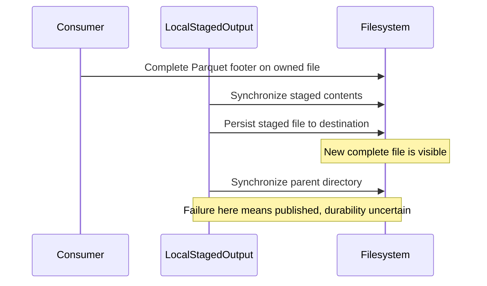
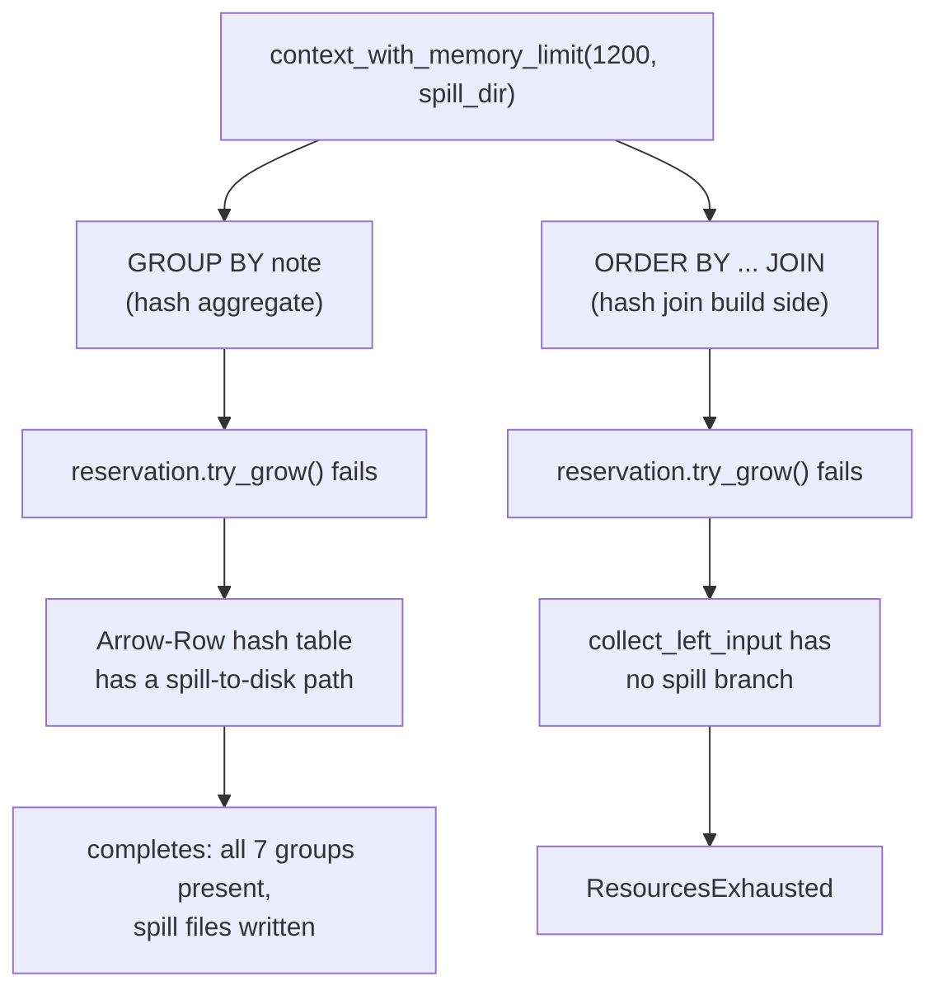

# The DataFusion pipeline: failure paths and resource control

`crates/pipeline` is where the CSV/Arrow fundamentals turn into an actual
query engine: `bounded.rs` runs a bounded CSV → Parquet pipeline with
cancellation and staged output, `datafusion_query.rs` runs real SQL
through DataFusion under a configurable memory limit. This chapter walks
both, live-test by live-test - code first, then the misconception a
Scala/Spark background invites, then the correction, then the bridge back to
something you already know.

## Cancellation and unique owned staging

Earlier, the local pipeline wrote to a deterministic `.tmp` sibling. Two runs
could open the same staging path, and cleanup by one could remove the other's
file. Each run now owns a unique file in the destination directory through a
private `LocalStagedOutput`. It reopens that owned file for the Parquet writer,
then publishes it only after successful encoding and file synchronization.
Using the destination directory keeps staging and publication on one filesystem.
Unique staging prevents name collisions; it does not coordinate concurrent writers
to the final path. The existing last-writer replacement policy still applies.

```console
$ cargo test -p pipeline a_pre_cancelled_token_stops_the_pipeline_before_any_output_is_published
$ cargo test -p pipeline owned_staging_unique_creation_and_drop_preserve_other_owners
```

A pre-cancelled token returns `PipelineError::Cancelled` before creating staging.
Later cooperative checks stop between records and batches and before publication.
Dropping an unpublished owner removes its own temporary file, best effort. It does
not delete another run's staging or an existing destination. Abrupt process failure
can leave temporary files; ordinary `Drop` does not run after every kind of crash.

**Scala/Spark bridge**: the token serves the same purpose as checking a task's
interrupted flag. It does not preempt an arbitrary callback or blocking I/O. The
staging owner serves the local resource role often expressed by `try/finally` or
`Resource`: scope exit releases that run's unpublished file.

## File visibility and durability are separate outcomes

A rename alone does not establish durability. The consumer first completes the
Parquet footer with `ArrowWriter::into_inner`. The staging owner then synchronizes
the file, persists it to the destination, and synchronizes the parent directory.
A bare relative filename uses `.` as its parent, so it takes the same directory
sync path. On Unix, staging preserves the earlier `File::create` permission policy:
mode `0666` restricted by the process umask. It does not silently switch published
files to tempfile's default owner-only mode.



Earlier, generic output errors obscured whether rename had already succeeded.
`PipelineError::LocalPublication` now carries the failed phase, final path,
visibility outcome and original source. A create, write, footer-close, file-sync
or rename failure reports `NotPublished`. If parent sync fails after successful
rename, the outcome is `PublishedDurabilityUncertain`: callers must inspect the
new destination rather than assume the old output remains unchanged.

These are local filesystem operations under the same-filesystem assumption.
Their durability depends on the filesystem and storage honoring synchronization.
The object-store route has its own backend and completion protocol; it cannot
inherit a transaction guarantee from local rename or Rust ownership.

## Failed encoding preserves the previous destination

```console
$ cargo test -p pipeline owned_staging_
$ cargo test -p pipeline writer_open_failure_cleans_up_and_publishes_nothing
```

The missing-directory regression checks `LocalPublication` at phase `Create` and
outcome `NotPublished`. Injected write and footer-close failures exercise both the
count-only and byte-budgeted consumers, preserve the prior destination and release
all admitted charges. Separate filesystem-edge injections cover file sync, persist
and parent sync; the last deliberately observes the newly published bytes despite
returning an error. Concurrent creation and drop tests verify distinct staging
paths and cleanup limited to the owner. Source-chain checks retain the underlying
I/O error kind for creation and reopening failures.

A reader of the final local file avoids partially encoded output under normal
same-filesystem rename semantics. An error after publication is still an error,
with a different recovery decision from an error before publication.

## Slicing shares the buffer - provably, not just by claim

**Claim**: slicing an Arrow array/batch shares the underlying allocation
instead of copying it - the reason the pipeline can stream large inputs
without multiplying memory use per stage.

**Code**: `crates/pipeline/src/lib.rs:541`,
`slicing_shares_the_underlying_buffer_instead_of_copying`:

```rust
let ids = Int64Array::from(vec![1, 2, 3, 4, 5]);
let sliced = ids.slice(1, 3);

let original_ptr = ids.to_data().buffers()[0].data_ptr();
let sliced_ptr = sliced.to_data().buffers()[0].data_ptr();

assert_eq!(
    original_ptr, sliced_ptr,
    "Array::slice should reuse the original buffer allocation, not copy it"
);
assert_eq!(sliced.values(), &[2, 3, 4]);
```

```console
$ cargo test -p pipeline slicing_shares_the_underlying_buffer_instead_of_copying -- --nocapture
```

The deliberate choice is `data_ptr()` over `as_ptr()`. `ids.slice(1, 3)`
doesn't copy - it creates a *view* into the same allocation starting at a
different logical offset. `as_ptr()` on the two arrays would differ, because
it accounts for each array's own offset; comparing those would make two
views of the same buffer look like different buffers. `data_ptr()` points at
the start of the underlying allocation itself, ignoring the view's offset,
so it correctly proves "these two arrays share one buffer" rather than
"these two arrays start reading from the same place."

**Scala/Spark bridge**: Spark's own in-memory columnar format (Tungsten's
off-heap `UnsafeRow`/`ColumnVector`, itself Arrow-influenced) makes the same
zero-copy claim for `.limit()` or a partition-local `.filter()`, but you
can't *prove* it from Scala the way this test proves it from Rust - the JVM
gives you no `data_ptr()`-equivalent, no legal way to compare two object
references for "do these share the same backing array" short of
`sun.misc.Unsafe` or a heap dump. In Rust it's an ordinary, safe assertion in
a unit test, because `Int64Array::slice` returns an owned Rust value whose
fields (an `Arc`-backed buffer plus an offset/length) are fully inspectable -
the JVM's object model treats reference identity as something you're not
meant to introspect from safe code.

## What a memory limit actually gates

```rust
pub fn context_with_memory_limit(
    max_bytes: usize,
    spill_dir: &Path,
) -> Result<SessionContext, DataFusionError> {
    let runtime = RuntimeEnvBuilder::new()
        .with_memory_limit(max_bytes, 1.0)
        .with_temp_file_path(spill_dir)
        .build_arc()?;
    Ok(SessionContext::new_with_config_rt(SessionConfig::new(), runtime))
}
```

(`datafusion_query.rs:436`)

**Misconception**: that `.with_temp_file_path(spill_dir)` is what *enables*
spilling - that without it, DataFusion refuses to write temp files and just
fails outright under memory pressure.

**Correction**, sourced against the pinned `datafusion-execution = 55.1.0`
source, not assumed from docs: `DiskManagerBuilder::default()` sets
`mode: DiskManagerMode::OsTmpDirectory` - spilling is on by default,
everywhere, no config needed. The `"temporary files are not enabled"` error
only fires under `DiskManagerMode::Disabled`, which nothing here sets.
`.with_temp_file_path(spill_dir)` exists purely so tests (and this chapter)
can point at a known, inspectable directory instead of the shared OS temp
dir. What `.with_memory_limit(max_bytes, 1.0)` actually gates is how much
memory an operator may reserve *before it must either spill or fail* - the
memory limit doesn't cause spilling on its own, and spilling doesn't require
a memory limit to be configured. They're independent knobs that happen to
interact: a low `max_bytes` is just the fastest way to *force* an operator
that already knows how to spill into actually doing it, instead of waiting
for a multi-gigabyte dataset to trigger the same path.

**Spark bridge**: the same trap as assuming `spark.local.dir` being set is
what makes shuffle spill possible. It isn't - shuffle spills to local disk
by default under memory pressure regardless; `spark.local.dir` just tells
Spark *where*. Same shape here: `with_temp_file_path` tells DataFusion
where, not whether.

## A memory limit doesn't mean everything spills the same way

Given one `context_with_memory_limit(1200, spill_dir)`, you'd expect a
constrained aggregate and a constrained join to fail - or succeed - the same
way. **They don't.** Run both:

```console
$ cargo test -p pipeline memory_limited_aggregate_spills_and_still_completes -- --nocapture
$ cargo test -p pipeline memory_limited_join_fails_with_resources_exhausted -- --nocapture
```

The aggregate test (`datafusion_query.rs:1195`) builds a `GROUP BY note`
over the 1200-byte-capped context and asserts it **completes**, with all 7
groups present, and that spill files were actually written:

```rust
let progress = ctx.runtime_env().spilling_progress();
assert!(
    progress.active_files_count > 0
        || spill_dir.path().read_dir().expect("read spill dir").count() > 0,
    ...
);
```

The join test (`datafusion_query.rs:1226`), under the *identical* 1200-byte
limit, asserts the query **fails**:

```rust
let err = result.expect_err("query must fail under this memory limit");
assert!(
    matches!(err.find_root(), DataFusionError::ResourcesExhausted(_)),
    "hash join build side has no spill fallback in datafusion 55.1.0 ..."
);
```



**Correction**: this is a real, documented asymmetry in DataFusion 55.1.0,
sourced directly from
`datafusion-physical-plan-55.1.0/src/joins/hash_join/exec.rs`,
`collect_left_input`, ~line 2265: the hash-join build side has a comment
`// Decide if we spill or not` immediately followed by
`state.reservation.try_grow(batch_size)?` - **with no spill branch**. A
failed `try_grow` just propagates `ResourcesExhausted` straight through `?`.
Hash-aggregation, by contrast, is mature/GA spillable - since the v27-28
vectorized rework it groups values into a single Arrow-Row-format
allocation with a hash table storing indexes, and that structure has a real
spill-to-disk path. Two distinct demos, not an inconsistency: one operator
in this DataFusion version can spill, the other genuinely can't.

**Scala bridge**: `err.find_root()` (used in the join test) matters for the
same reason unwrapping a chained `Throwable`'s `getCause()` matters on the
JVM - the join's `ORDER BY` adds a sort stage after the hash join, so
DataFusion may wrap the underlying `ResourcesExhausted` in a `Context(..)`
error from that later stage. `find_root()` is the Rust-side equivalent of
walking `getCause()` until you hit the actual failure instead of asserting
against whatever wrapper happened to be outermost.

## No GC doesn't mean queries can't pause

It's tempting, once you've internalized "Rust has no GC," to overcorrect
into "so a DataFusion query never blocks or pauses for memory bookkeeping."
Both tests above disprove this - a memory-limited aggregate *does* pause: it
stops, spills, and resumes.

**Correction**: Spark's `UnifiedMemoryManager` shares one JVM heap between
execution and storage regions elastically, execution given priority, storage
evicted LRU-first when execution needs space; both regions can spill.
DataFusion's `MemoryPool` trait (`GreedyMemoryPool`, `FairSpillPool`,
`TrackConsumersPool`) is a pluggable **per-query/per-operator reservation
strategy**, not a single shared heap region - a different design, not "Rust
doesn't need memory management." The precise, defensible claim about GC is
narrower: DataFusion's memory accounting doesn't stop-the-world across
unrelated queries the way a tracing GC pause can; it's explicit reservation
and explicit spill logic per operator. "No tracing GC" ≠ "queries can't
pause" - they can, deliberately, for exactly the reason you'd expect (not
enough memory for the current step), and you can watch it happen via
`spilling_progress()`.

## Dropping a stream cleans up - no separate `Resource` API needed

The temptation from a Cats Effect background is to look for something like
DataFusion's own `Resource`/`bracket` - a `.use { }` block, an explicit
cancel-and-cleanup API - and be surprised there isn't one.

```rust
let mut stream = ctx.sql(GROUP_BY_NOTE_SQL).await?.execute_stream().await?;
stream.next().await;
drop(stream);
```

(`datafusion_query.rs:1259`, from `dropping_stream_early_cleans_up_spill_files`, test at `:1250`)

```console
$ cargo test -p pipeline dropping_stream_early_cleans_up_spill_files -- --nocapture
```

**Correction**: there's no separate cleanup step to look for, because
there's no separate `Resource` type in the first place. This is Rust's
ordinary `Drop` semantics on the stream value itself - pull one batch, then
`drop(stream)`, and whatever temp-file guards the streaming execution was
holding (`RefCountedTempFile`) run their `Drop` impl the moment the stream
goes out of scope, deterministically. The test polls rather than asserting
instantly, though:

```rust
let mut progress = ctx.runtime_env().spilling_progress();
for _ in 0..1000 {
    if progress.active_files_count == 0 { break; }
    tokio::task::yield_now().await;
    progress = ctx.runtime_env().spilling_progress();
}
assert_eq!(progress.active_files_count, 0, ...);
```

Why: the aggregation's spilling runs on a spawned task that observes the
dropped receiver *asynchronously*, not synchronously on drop. Cleanup is
deterministic in the "it will definitely happen, via ordinary scope exit"
sense, but not synchronous in the "happens on the exact line `drop(stream)`
runs" sense - don't mix up the two.

**Cats Effect bridge**: this is the same guarantee `Resource`/`bracket`
gives at runtime - acquire, use, release, release runs even on early exit or
failure - except the borrow checker enforces the *shape* of it at compile
time instead of a runtime interpreter running a release action on your
behalf. A struct that owns a file handle or spill directory releases it the
moment it goes out of scope. No `.use { }` block, because there's nothing to
opt into - it's the default behavior of every owned value in Rust, not a
library feature layered on top.

The ordered row query now has a shared `row_query_plan` used by both the
collecting wrapper and `stream_orders` example. Its regressions check
independent expected values, order and nulls, projection that removes the
predicate column, empty/limited results, conditional cast errors, and
release of query reservations after an early stream drop. These are
consumer and semantic checks; a global sort can still buffer upstream.
The existing constrained aggregate/spill test checks its separate cleanup
path under the configured runtime.

## Count logical reads after checking the result

Earlier pushdown checks used engine plan metrics. The test-only
`query_io_tests` wrapper now also observes the `ObjectStore` registered on
the query's actual runtime. It forwards read options and response metadata,
and separately counts attempted HEADs, attempted GETs, successful GET
responses, requested bytes in bounded ranges, non-bounded GETs, and payload
bytes actually yielded to the reader. A failed precondition increments
attempts but contributes no successful response or payload bytes. Repeated
logical reads count again. The test's measurement boundary includes table
registration and query execution.

These are library observations. HTTP retries, cache hits beneath the
wrapper, wire bytes and billed requests are unavailable, not zero. A
selective multi-row-group fixture must first match independent expected
IDs with pruning enabled and disabled; only then does it check avoided
payload work. Another fixture verifies its Parquet metadata has no column
statistics and checks the same null/boundary results with pruning both
ways. Missing statistics cannot justify discarding candidate rows.
A controlled GET failure while the listing remains valid verifies that
stream errors reach the consumer. Removing a file before physical planning
can instead produce an empty listing, which is a different condition.

## Run the whole chapter live

```console
$ RUST_LOG=pipeline=debug cargo test -p pipeline memory_limited -- --nocapture
$ RUST_LOG=pipeline=debug cargo test -p pipeline dropping_stream_early_cleans_up_spill_files -- --nocapture
$ cargo test -p pipeline
```

`context_with_memory_limit` is `#[tracing::instrument(...)]`
(`datafusion_query.rs:435`) - with `RUST_LOG=pipeline=debug` and
`--nocapture`, the span prints the spill directory actually in use.
