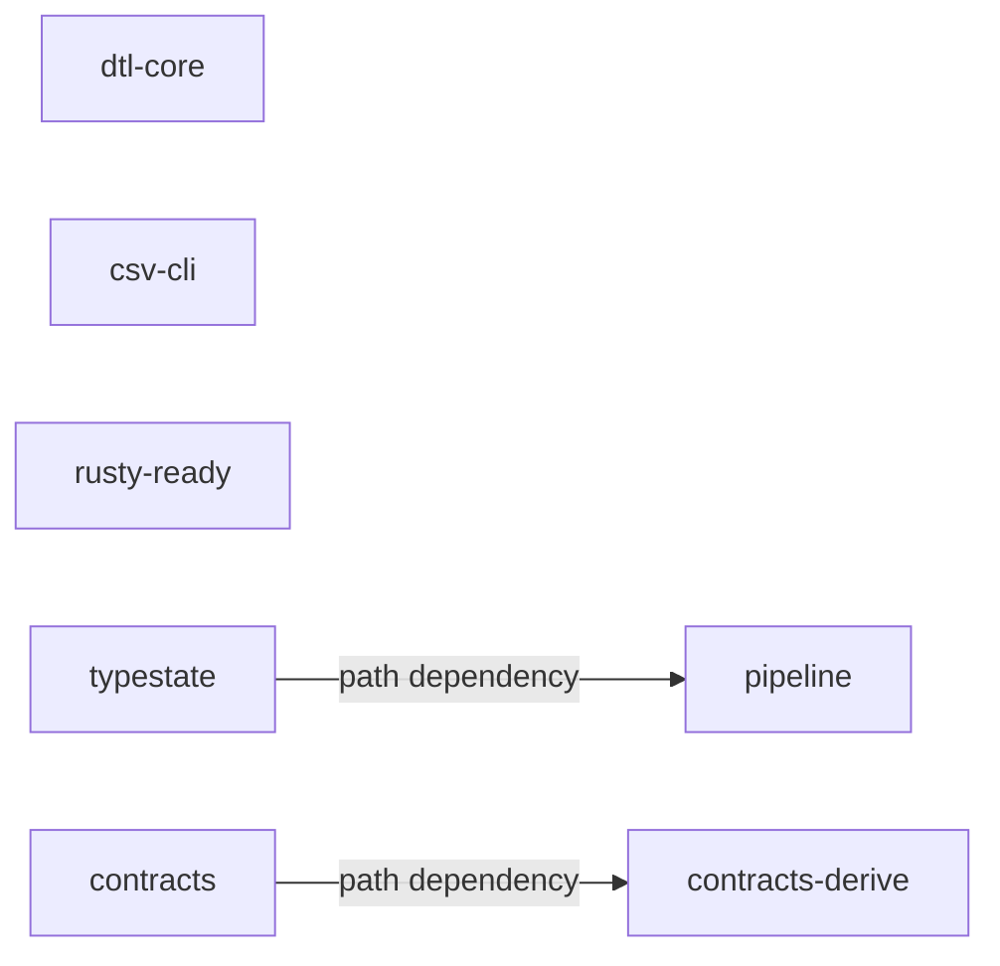

# Getting Started


`datacrate` is a Rust data-engineering workspace covering CSV/Arrow ingestion,
Parquet storage, DataFusion SQL and DataFrame queries, and cloud object-store I/O.
Optional Ballista examples explore distributed execution. Comet examples accelerate
operators inside Spark, which retains its JVM runtime.

The current guarantees apply at distinct boundaries:

- **Contract declarations:** explicit, evaluated `SchemaConforms::CHECK` or
  `contracts::enforce` checks compare Rust type shapes during `cargo build`.
  They do not inspect external files, SQL results or arbitrary callback output.
- **Builder configuration:** typestate requires source, transform and sink stages
  before `build()` is available. Callback success and data validity remain runtime checks.
- **Ingest batches:** local and bounded pipeline callbacks return `Result` and
  must preserve the fixed `id`, `name`, nullable `note` schema. Actual batches
  are checked at runtime before being accepted by the corresponding consumers.

The optional Contract-to-Arrow adapter constructs physical schemas and returns
errors for unsupported representations. It does not certify array values.
Resource controls and publication protocols have explicit limits documented in
the guide; no general performance or end-to-end schema-safety guarantee follows
from compiling the workspace.

## Prerequisites

- [rustup](https://rustup.rs/) - the pinned toolchain in `rust-toolchain.toml`
  (stable, with `rustfmt` and `clippy`) is installed automatically on first
  `cargo` invocation in this directory.
- [`just`](https://github.com/casey/just) - task runner used for all dev
  commands (`cargo install just` or via your package manager).

## Workspace layout

```
crates/
├── dtl-core/          lib   - ownership/borrowing/slices fundamentals, zero-copy CSV batching
├── csv-cli/           bin   - streaming CSV column-selection CLI (csv-select)
├── pipeline/          lib   - Arrow/Parquet/DataFusion pipeline, object-store I/O,
│                              Ballista distribution, Comet acceleration
├── typestate/         lib   - typestate pipeline builder (source/transform/sink)
├── contracts/         lib   - compile-time schema-conformance checking
├── contracts-derive/  lib   - `#[derive(Contract)]` proc macro backing `contracts`
└── rusty-ready/       lib   - general Rust practice and playground, isolated from the other crates
│                              (exercises/ subdir: workshop compiler-error drills)
fixtures/         deterministic test data, committed
```

The directory tree above shows where the code lives, not which crates
actually depend on which. The real dependency graph is much sparser - only
two workspace crates have a path dependency on another workspace crate at
all:



`dtl-core`, `csv-cli`, `pipeline`, `contracts-derive`, and `rusty-ready` never
depend on another workspace crate - each is a leaf you can build, test, and
reason about on its own.

Why `dtl-core` and not just `core`: Rust ships its own built-in `core`
crate (the `#![no_std]`-compatible base of the standard library). Naming a
workspace crate `core` would shadow it - any `use core::...` elsewhere in
the workspace would silently resolve to the wrong one instead of failing
loudly. `dtl-core` sidesteps the collision entirely.

## Quick start

```sh
git clone <this-repo>
cd datacrate
just verify   # fmt check, clippy (warnings denied), tests, release build
```

Run the CSV column-selection CLI directly:

```sh
cargo run -p csv-select-cli --bin csv-select -- fixtures/m1/headers.csv --column 1
```

Continue to [Usage](usage.md) for a walkthrough of `csv-select` and the
`dtl-core` library, or jump straight to any other chapter: the deep dive on
[ownership and streaming](ownership.md), the
[typestate pipeline builder](typestate.md), the
[DataFusion pipeline](datafusion.md), the
[object-store edge](object-store.md),
[distributing DataFusion and accelerating Spark](distributed-and-acceleration.md),
or [compile-time schema contracts](contracts.md).
