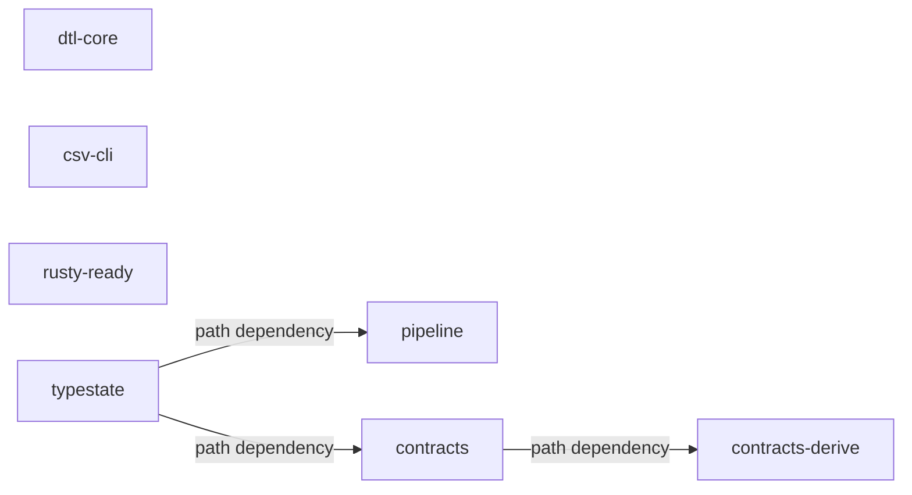

# Getting Started


`datacrate` is an end-to-end data-engineering platform in Rust, under active
development. One Cargo workspace brings together streaming CSV/Arrow ingestion,
compile-time schema contracts, typestate pipeline builders, Parquet storage,
DataFusion SQL and DataFrame queries, and cloud object-store I/O. Ballista examples
extend query execution across scheduler and executor processes; Comet examples
explore native acceleration inside Spark.

The engineering focus is on explicit pipeline boundaries: compiler-resolved type
shapes and const-evaluated compatibility checks, fallible callbacks with checked
batch output, bounded batch transport with optional byte admission, captured object
identity, and owned output publication with recoverable failure information. The
core pipeline runs natively in Rust; Comet operates within Spark's JVM runtime.

### Where the guarantees apply

- **Contracts** compare Rust declarations when an explicit check or typed
  stage connection is instantiated by `cargo build`. The opt-in Arrow validator
  checks actual batches against supported physical schemas. `#[derive(Connector)]`
  builds on the same derived shape to register a contract's batches on a
  DataFusion `SessionContext` - in memory, or from Parquet/CSV with the
  contract's schema taken as authoritative over the file - and to generate one
  typed `col_<field>()` accessor per field, so a renamed field breaks the
  build instead of a query silently returning zero rows.
- **Typed pipeline** automatically checks every declared source, transform and
  sink connection during a build, then validates source and transform batches
  before downstream callbacks. A transform stage can run SQL instead of a Rust
  closure via `sql_transform` and still gets the same compile-time check. The
  existing builders still enforce their own stage-presence rules; callback
  failures remain runtime results.
- **Ingest validation** checks actual callback output against the current fixed
  `id`, `name`, nullable `note` schema before accepting it at the pipeline boundary.

These layers complement each other. External data still needs runtime validation;
memory accounting, schema mappings and publication guarantees have defined scopes
explained in the guide.

## Prerequisites

- [rustup](https://rustup.rs/) - the pinned toolchain in `rust-toolchain.toml`
  (stable, with `rustfmt` and `clippy`) is installed automatically on first
  `cargo` invocation in this directory.
- [`just`](https://github.com/casey/just) - task runner used for all dev
  commands (`cargo install just` or via your package manager).

## Workspace layout

```
crates/
├── dtl-core/          lib   - ownership/borrowing/slices fundamentals, zero-copy CSV batching
├── csv-cli/           bin   - streaming CSV column-selection CLI (csv-select)
├── pipeline/          lib   - Arrow/Parquet/DataFusion pipeline, object-store I/O,
│                              Ballista distribution, Comet acceleration
├── typestate/         lib   - typestate pipeline builder (source/transform/sink)
├── contracts/         lib   - compile-time schema-conformance checking
├── contracts-derive/  lib   - `#[derive(Contract)]` proc macro backing `contracts`
└── rusty-ready/       lib   - general Rust practice and playground, isolated from the other crates
│                              (exercises/ subdir: workshop compiler-error drills)
fixtures/         deterministic test data, committed
```

The directory tree above shows where the code lives, not which crates
actually depend on which. Two workspace crates have path dependencies on
other workspace crates, across three edges:



`dtl-core`, `csv-cli`, `pipeline`, `contracts-derive`, and `rusty-ready` never
depend on another workspace crate - each is a leaf you can build, test, and
reason about on its own.

Why `dtl-core` and not just `core`: Rust ships its own built-in `core`
crate (the `#![no_std]`-compatible base of the standard library). Naming a
workspace crate `core` would shadow it - any `use core::...` elsewhere in
the workspace would silently resolve to the wrong one instead of failing
loudly. `dtl-core` sidesteps the collision entirely.

## Quick start

```sh
git clone <this-repo>
cd datacrate
just verify   # fmt check, clippy (warnings denied), tests, release build
```

Run the CSV column-selection CLI directly:

```sh
cargo run -p csv-select-cli --bin csv-select -- fixtures/m1/headers.csv --column 1
```

Continue to [Usage](usage.md) for a walkthrough of `csv-select` and the
`dtl-core` library, or jump straight to any other chapter: the deep dive on
[ownership and streaming](ownership.md), the
[typestate pipeline builder](typestate.md), the
[DataFusion pipeline](datafusion.md), the
[object-store edge](object-store.md),
[distributing DataFusion and accelerating Spark](distributed-and-acceleration.md),
or [compile-time schema contracts](contracts.md).
