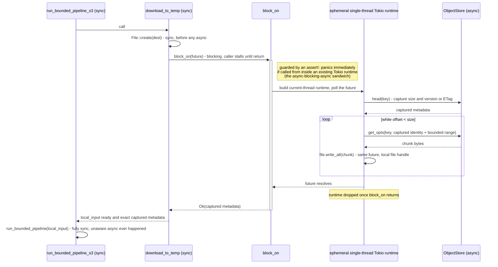

# The object-store edge: bridging sync and async without a sandwich

`crates/pipeline/src/object_store_io.rs` is the one place in this codebase
that bridges synchronous ingest with asynchronous storage calls. DataFusion
queries also use async; the bounded CSV pipeline stays synchronous by
design; this module's whole job is to let a synchronous pipeline read from
and write to S3 (or a MinIO-compatible bucket) without dragging `async` into
the rest of the call stack. Read it alongside `crates/pipeline/src/bin/run-s3-pipeline.rs`
(the CLI that drives it end to end) and `docker-compose.minio.yml` (the local
stand-in for S3). If you're coming from Scala/Spark, the interesting bridge
here isn't cloud storage - it's what happens when a language *without* a
green-thread runtime baked into every function call has to talk to a library
that only offers `async fn`.

## Why this module exists instead of `async` spreading everywhere

`object_store::ObjectStore`'s trait methods are all `async fn` - there's no
synchronous variant to call instead. The rest of the pipeline
(`run_bounded_pipeline`, the CSV reader, the Parquet writer) is deliberately
synchronous: no `Tokio`, no `.await`, ordinary blocking I/O. `object_store_io.rs`'s
job is to be the seam between those two worlds without forcing the sync side
to become async.

```rust
fn block_on<F: std::future::Future>(future: F) -> F::Output {
    assert!(
        tokio::runtime::Handle::try_current().is_err(),
        "object_store_io::block_on called from inside an existing Tokio \
         runtime - this is the async-blocking-async sandwich and would \
         panic or deadlock. Once a caller runs inside async code, replace \
         this call with tokio::task::spawn_blocking instead."
    );
    tokio::runtime::Builder::new_current_thread()
        .enable_all()
        .build()
        .expect("current-thread tokio runtime should build")
        .block_on(future)
}
```

(`object_store_io.rs:33`)

Each call to `download_to_temp` or `upload_from_temp` spins up its own
short-lived, single-threaded Tokio runtime, drives exactly the async work it
needs on it, and lets it drop. No async runtime persists across calls into
this module, and nothing outside this module ever needs to know Tokio
exists.

**Scala/Spark bridge**: this is a deliberate rejection of the shape Cats
Effect or ZIO nudges you toward - one runtime constructed at the top of
`main` and threaded everywhere. That shape is the right one when *most* of
your program is effectful. Here, almost none of it is: one CSV reader, one
Parquet writer, one channel between two threads, all synchronous, with a
single narrow edge that happens to need async because the S3 SDK demands it.
Building a runtime per call is more expensive than a shared one, but the
alternative - infecting `run_bounded_pipeline` and everything it calls with
`async fn` and `.await` - would cost far more in complexity for zero benefit
to the 95% of the pipeline that never touches the network.



Nothing above `block_on` ever holds a `.await` - the runtime is built, used for
exactly one call, and dropped before control returns to synchronous code.

## The assertion that turns a silent deadlock into a named panic

The dangerous failure mode this module guards against is calling
`block_on` from code that is *already* running inside a Tokio runtime - the
"async-blocking-async sandwich" Tokio's own docs warn about. A
single-threaded runtime blocking inside another runtime's worker thread can
deadlock or panic deep inside Tokio's internals, at a call site with no
obvious connection to `object_store_io.rs`.

```console
$ cargo test -p pipeline block_on_from_inside_a_running_runtime_panics_immediately -- --nocapture
```

The test (`object_store_io.rs:575`) is itself an `#[tokio::test]` - already
running inside a runtime - and calls `download_to_temp` from within it,
asserting the resulting panic message contains `"async-blocking-async
sandwich"`. The `assert!` at the top of `block_on` (`object_store_io.rs:34`)
is what turns "mysterious internal Tokio panic three frames down" into "a
named, first-frame panic that tells you exactly what invariant you broke and
what to do about it." The actual fix for when this module *is* reached from
async code is to swap `block_on` for `tokio::task::spawn_blocking` - not to
delete the assertion.

**Scala bridge**: this is the same category of bug as blocking a Cats
Effect / ZIO fiber's worker thread with a synchronous call that itself blocks
on that same runtime - `IO.blocking` / `ZIO.attemptBlocking` exist precisely
to move such work off the shared worker pool. The assertion here is a
compile-time-adjacent guard turned into a fail-fast runtime check for a
constraint Rust's type system doesn't encode on its own: nothing in
`block_on`'s signature stops you from calling it from async code, so the
module defends the invariant explicitly instead of hoping callers remember
it.

## Bound transfer buffers independently of object size

```rust
const CHUNK_BYTES: usize = 8 * 1024 * 1024;
```

(`object_store_io.rs:29`)

`download_to_temp` (`object_store_io.rs:118`) doesn't call `store.get(key)`
and write the whole object to disk in one shot. Earlier it captured a size
and issued unconditional range reads. Now it captures one `ObjectMeta`,
selects its version when available or its ETag otherwise, and binds every
bounded `GetOptions` request to that identity. It validates returned
identity, key, total size, range and body length before reporting success.
Body chunks are checked as they arrive, so an oversized response is not
collected into an arbitrarily large buffer. A failed download may leave a
partial destination; callers must discard it.

`download_to_temp` returns that same captured metadata. The S3 pipeline
uses it for the manifest and no longer performs an independent HEAD.
Missing validators and unsupported conditional requests fail explicitly;
there is no unconditional retry. An empty object still requires a captured
identity but needs no data ranges. Success describes the captured empty
object, not a guarantee that the latest key remains unchanged afterward.
This binds one sequential object download; it does not snapshot a
multi-file analytical dataset. Backend support for conditional/versioned
reads remains a requirement.
The first upload loop limited reads but left multipart scheduling unbounded.
It now owns at most two outstanding 8 MiB parts and refills a free slot even
while another part stalls. Short local reads are accumulated into aligned parts;
only the final part may be smaller. One additional part buffer is filled locally.
Backend/runtime allocations remain outside this accounting, so this is not an
exact process RSS ceiling.

Earlier error paths could drop the upload without aborting its remote multipart
session. The private helper now retains the upload, drops outstanding part futures,
and explicitly attempts abort after a read, part or completion failure. If abort
also fails, `MultipartAbort` retains the original error and the secondary abort
error. A process crash cannot run this async recovery. Configure backend lifecycle
rules for abandoned multipart uploads; deleting an object key does not abort an
incomplete multipart session.

`CHUNK_BYTES` is chosen deliberately, not arbitrarily: 8 MiB sits comfortably
above `object_store`'s 5 MiB multipart-part minimum, so uploads don't pay a
part-per-tiny-chunk penalty, while staying small enough to limit each payload
buffer. The part concurrency limit and backend allocations also contribute to
peak memory.

**Scala/Spark bridge**: this is the same shape as Spark reading a file in
partition-sized blocks rather than collecting it to the driver - the size of
the whole object does not need to reside in memory when both reads and
in-flight uploads are bounded. The difference is that Spark makes
this the default behavior of `spark.read`, invisible to the caller; here,
`CHUNK_BYTES` and the `while offset < size` loop are visible, hand-written,
and exactly as large as they need to be for this specific edge.

## Errors name which side failed, not just that something did

Earlier, a private `DownloadStepError` combined backend and local I/O
errors and translated them on return. The download now maps failures at
the operation that failed, because its captured-object checks introduce
additional protocol errors. `DownloadObject` preserves backend failures,
`OpenOutput` preserves local file failures, `SnapshotPrecondition`
preserves rejected read conditions, and `InvalidSnapshot` carries a typed
`SnapshotViolation` for missing identity or malformed responses. A failed
condition never becomes an unconditioned retry.

```console
$ cargo test -p pipeline download_of_a_missing_key_reports_download_object_not_a_panic -- --nocapture
```

The test (`object_store_io.rs:562`) asserts a missing key produces
`Err(PipelineIoError::DownloadObject { .. })`, not a panic - the boring but
load-bearing guarantee that a network/store failure is just data flowing
through `Result`, indistinguishable in kind from any other error this crate
returns.

**Scala bridge**: these errors serve the role of a small sealed error
hierarchy: callers distinguish local I/O, backend failures and violated
read conditions without parsing messages. Pure comparisons validate
metadata; the object-store and file calls remain the action boundary.

## Round-tripping through an in-memory store, not a real bucket

```console
$ cargo test -p pipeline round_trips_bytes_through_the_store_and_a_local_temp_file -- --nocapture
```

(`object_store_io.rs:534`)

The test seeds an `object_store::memory::InMemory` store, downloads through
`download_to_temp`, re-uploads through `upload_from_temp`, and asserts the
bytes match byte-for-byte. `InMemory` implements the exact same
`ObjectStore` trait `AmazonS3Builder::from_env()` produces in
`run-s3-pipeline.rs` - so this test exercises the real chunking, error
handling, and `block_on` logic in this module without a network call or a
running MinIO container anywhere in the test process. Nothing about
`download_to_temp` or `upload_from_temp` is aware it's talking to memory
instead of S3; that's the entire value of coding to the `ObjectStore` trait
object (`&dyn ObjectStore`) instead of a concrete `AmazonS3` type.

## The CLI adds nothing this module didn't already decide

```rust
let store = AmazonS3Builder::from_env()
    .with_bucket_name(&args.bucket)
    .build()
    .map_err(|source| CliError::BuildStore { source })?;
```

(`run-s3-pipeline.rs:89`)

`run-s3-pipeline` is deliberately thin. `AmazonS3Builder::from_env()` reads
the standard AWS environment variables - `AWS_ACCESS_KEY_ID`,
`AWS_SECRET_ACCESS_KEY`, `AWS_ENDPOINT_URL`, `AWS_REGION`, `AWS_ALLOW_HTTP` -
which is what lets the exact same binary point at real S3 or at a local
MinIO container with no code path forking on which one it's talking to: only
the environment differs.

```console
$ docker compose -f docker-compose.minio.yml up -d
$ export AWS_ACCESS_KEY_ID=minioadmin
$ export AWS_SECRET_ACCESS_KEY=minioadmin
$ export AWS_ENDPOINT_URL=http://localhost:9000
$ export AWS_REGION=us-east-1
$ export AWS_ALLOW_HTTP=true
$ cargo run --bin run-s3-pipeline -- \
    --bucket demo \
    --input-key input.csv \
    --output-key output.parquet
wrote N batch(es), M row(s) to s3://demo/output.parquet
```

The CLI's only real job (`run-s3-pipeline.rs:101`) is calling
`run_bounded_pipeline_s3` (`bounded.rs:487`) and translating its
`Result` into an exit code - everything about chunked streaming, the
sync/async boundary, and error translation already happened inside
`object_store_io.rs`, not here.

## `run_bounded_pipeline_s3` doesn't rewrite the pipeline for S3

The remote entry point still stages input and output on local disk and reuses
`run_bounded_pipeline`. Earlier, its final upload and manifest handling hid remote
publication boundaries behind rename-like operations. Now it passes the completed
local file and the captured input metadata into one private publication owner:

1. Upload to this run's unique `<output>.staging/<run-id>` key.
2. Remove the previous completion marker.
3. Copy the staged object to the fixed final key.
4. Capture the final object's version or ETag.
5. PUT a version-2 completion record bound to that identity.
6. Delete only this run's staging object.

This keeps CSV batching and local publication in their existing owner. Remote
publication has its own failures because an object store cannot commit output and
completion in one transaction. The protocol requires externally enforced **one
writer per output key**. Random run namespaces prevent staging collisions; they
provide no distributed lock. Bucket permissions and key-length limits must allow
the longer staging keys as well as final and manifest keys.

A pre-cancelled run returns before storage access. Cancellation is checked again
before remote publication starts. Once that protocol starts, it finishes or returns
its actual phase error; cancellation does not roll back remote effects or interrupt
arbitrary backend I/O. Local disk must accommodate the captured input and output.

**Scala/Spark bridge**: this is the shape of writing one Spark job against
`DataFrameReader`/`DataFrameWriter` and letting the `s3a://` vs `file://`
scheme in the path decide which filesystem implementation actually runs -
except here that boundary is drawn by hand, one small function, instead of
being an abstraction the framework provides for you. `ObjectStore`, in that
sense, is `object_store`'s version of Hadoop's `FileSystem` trait: one
interface, multiple backends, and application code that never needs to know
which one it's talking to.

## Atomic isn't durable: fsync before the rename

The local owned-staging pattern (write a unique sibling, persist into
place) guarantees a reader never observes a half-written file - that's
atomicity. It does not by itself guarantee durability: a crash right after
the rename "succeeds" can still lose bytes that were buffered in the OS page
cache but never flushed, or lose the directory-entry update the rename
itself made, depending on filesystem behavior. Those are two different
promises, and the local pipeline `run_bounded_pipeline_s3` reuses unchanged
(see above) makes both of them explicit rather than assuming rename implies
fsync.

The fix is two `fsync` calls, not one. First, the Parquet writer is closed
through the path that hands back its underlying file handle - not the
convenience method that drops it - so `sync_all()` can flush all buffered
data, including the Parquet footer, before the rename happens. Second,
immediately after the rename, the output's *parent directory* is opened and
`sync_all()`'d too - that second fsync is what makes the rename's own
directory-entry update durable, not just atomic-looking. Skipping it would
leave a window where the file's bytes are safely on disk but the directory
still doesn't reliably point at them after a crash.

**Scala/Spark bridge**: this is the same distinction Spark's
`FileOutputCommitter` draws between writing task output to a staging path
and the final commit that makes it visible - "visible" and "durable" are
different guarantees, and a committer that only handles the rename without
forcing the underlying writes to disk has the identical gap this pipeline
closes by hand.

## The completion manifest: recorded counts, input metadata and a fingerprint

`run_bounded_pipeline_s3` publishes a `.manifest.json` sibling after the final
Parquet object. Earlier this record carried only counts, input metadata and a
fingerprint. Now version 2 also binds completion to the output identity observed
after copy. The record is a separate PUT, not a staged rename and not a transaction
with the output. Its presence alone does not verify output bytes.

The manifest carries a snapshot of the input object (key, size, ETag,
last-modified) plus the output's row count and a content digest. The digest
is the interesting part: it has to answer "does this output's *content*
match what I expect" without caring about row order or which batch a row
landed in, since the bounded pipeline streams output in chunks and nothing
about that chunking should leak into what "the same data" means. So each
row is hashed individually with a fixed-seed `ahash::RandomState` - fixed,
because `ahash`'s normal per-process-random seeding is built to resist
hash-flooding attacks against hash maps, which is exactly wrong for a
fingerprint that must be reproducible across runs of identical content - and
the per-row hashes are combined with wrapping `u64` addition, not XOR.
XOR was the obvious first choice and the wrong one: `x ^ x == 0`, so a run
that silently dropped one of two duplicate rows would XOR-hash identically
to the correct run. Wrapping addition doesn't cancel like that
(`accumulate_batch_digest`, `manifest.rs:67`, and the
`duplicate_rows_do_not_cancel_out` test that pins this down,
`manifest.rs:461`). The whole computation runs one row at a time, so the
digest never buffers more than a single row's hash regardless of how large
the output is - it doesn't reopen the memory-envelope question the bounded
pipeline already answered for the rest of this path.

The digest is order-independent, so it intentionally cannot detect row
reordering. Collisions can also hide content changes. Earlier wording in
ADR 0012 included reordered rows among detectable changes; that exceeded
what this combiner can establish. Fixed seeds preserve repeatability for
the pinned build, not a portable cross-version or cross-platform hash
format. It is neither an equality proof nor an authenticity check.

The original JSON fixture preserved a supplied digest string, which did not test
whether the hashing implementation still produced that value. An independent
baseline executable now supplies 36 captured observations covering empty input,
null and empty notes, empty names, field boundaries, duplicates, Unicode, integer
extrema and different batch sizes. The candidate reproduces them on the same
compiler and target configuration. A committed regression fixture is limited to
AES-enabled aarch64 macOS with the pinned Rust and ahash versions. Changing a seed
makes that regression fail. Other targets still need their own baseline captures;
this evidence does not turn the legacy scheme into a portable format.


Earlier, readers decoded JSON directly and could accept any numeric
`schema_version`. Use `manifest::decode_completion_manifest` now: it checks
the supported version and version-specific fields before returning a usable manifest. The publisher
also refuses unsupported versions. Malformed JSON and missing required
fields retain JSON error sources; an unsupported numeric version has a
separate typed error. The persisted version-1 fixture keeps the original
field values and hexadecimal digest string. Raw `serde_json::from_slice`
is still available for inspection, but does not replace supported-version
validation.

The reader accepts versions 1 and 2 and rejects other versions. Version 2
adds `run_id`, optional `input_version`, `output_key`, `output_e_tag`,
`output_version` and `digest_scheme`. A nonempty run ID, output key and at
least one nonempty output identity are required. The only implemented
scheme is `legacy-ahash-wrapping-sum-v1`, which labels the existing hash;
it does not change its bytes or strengthen its guarantees. Unknown
schemes have a separate typed error. Missing new fields remain valid for
version 1, whose serialized field set stays unchanged.

The remote pipeline now emits version 2. `put_manifest` accepts validated versions
1 and 2 for callers that need either format; unknown versions are rejected.
`download_completed_output` requires version 2 and checks the recorded output key.
It reads the recorded version when available, otherwise enforces the recorded ETag
on HEAD and every bounded range. It refuses version 1 with
`CompletionIdentityRequired`; the checked decoder still reads those legacy records.
Existing JSON-only consumers must migrate to the protocol-aware reader.

A versioned bucket can return the completed historical version after the latest
key changes. An ETag-only bucket rejects a changed object. Neither behavior proves
that the record is the newest successful run. Conditional/version request support
is a backend prerequisite. Reader errors can leave a partial local destination,
which callers must discard. Identity checks do not recompute row count or digest.
The `verify_completion` example additionally decodes bounded Parquet batches and
checks row count; it prints the recorded fingerprint without recomputing it.

`RemotePublication` errors expose the failed phase, output/manifest/staging keys,
primary source and any secondary staging-delete failure. Before copy, the outcome
is `NotPublished`. A failed copy is `PublicationUnknown`, because the request may
have taken effect. After successful copy, identity failures report
`PublishedWithoutCompletion`. A failed completion PUT is `CompletionUnknown`.
After successful completion, a staging-delete error is
`CompletedCleanupUnknown`: deletion may itself have taken effect. Recovery must
inspect these states. It must never blindly delete the shared final key; an older
failed run could otherwise remove a newer output.

Owned staging is deleted explicitly on success and attempted on ordinary failure.
No remote I/O runs from `Drop`. Crashes can leave orphan objects or multipart
sessions, so retention/recovery procedures remain operational responsibilities.
This buys detectable, identity-bound completion at the cost of a temporary missing
completion signal during overwrite and external writer coordination. It supplies
neither exactly-once execution nor multi-object atomicity.

## Try it yourself

```sh
cargo test -p pipeline object_store_io::
docker compose -f docker-compose.minio.yml up -d
cargo run --bin run-s3-pipeline -- --bucket demo --input-key input.csv --output-key output.parquet
cargo run -p pipeline --example verify_completion -- --bucket demo --output-key output.parquet --destination /tmp/completed.parquet
docker compose -f docker-compose.minio.yml down
```

The in-memory tests prove the logic; the MinIO round trip proves the wiring.
Both are worth running - they check different things, and neither one
substitutes for the other.

## Check transformed data before writing or hashing it

The bounded consumer previously trusted a transform to preserve the ingest schema.
A renamed `id` field could still be written and hashed successfully because the two
consumers relied on column positions and physical types. The consumer now constructs
a checked batch before either operation. It requires exactly `id: Int64`, `name: Utf8`
and nullable `note: Utf8`, in that order, with nonnullable `id` and `name`.

Writer and digest share that checked output. Invalid names, types or nullability return
`InvalidBatch` before writing transformed data; schema metadata is not interpreted.
This validates the fixed ingest representation, not business rules or arbitrary declared
contracts. The digest's typed views share Arrow buffers instead of copying payloads.

## A batch count does not bound variable-width bytes

Earlier, the channel limited only the number of batches. A thousand short strings
and a thousand multi-megabyte strings occupy very different amounts of memory, so
that count alone could not express an operator's retention budget. The optional
`PipelineConfig.max_admitted_bytes` now admits each finished producer batch against
an Arrow array memory charge. Both pipeline CLIs expose `--max-admitted-bytes` as a
positive byte count. The default remains count-only.

The charge sums each column's `get_array_memory_size()` with checked addition.
Shared or sliced buffers can be counted repeatedly. It is a conservative declared
accounting rule, not unique allocated bytes or process RSS. One batch being built,
CSV parser records, callback internals, Parquet buffers, network/runtime buffers and
allocator overhead remain outside it. Admission after construction cannot prevent
one extremely large input record from allocating memory first.

A private lease retains the reservation while queued, during a transform, and
through validation, writing and hashing. Receiving a batch frees a count slot but
does not free its bytes. Dropping its reservation releases them once. A returned
transform may grow only if the extra charge is immediately available; otherwise it
returns `BatchGrowthExceedsBudget`. Waiting there could deadlock because only that
consumer can drain the queued batches holding the remaining bytes. Shrinking keeps
the original charge conservatively until the lease ends.

The budgeted route uses one mutex and condition variable for count, rendezvous and
byte predicates. Capacity zero still requires receiver acknowledgment. Cancellation
wakes registered budgeted transports, including runs sharing one token; receiver
closure discards only that transport's queued work. It does not interrupt arbitrary
callbacks, file reads or backend I/O. The count-only route retains its existing
cooperative cancellation behavior. Successful reports expose current and peak
charges as `Some`; count-only reports use `None`, so unavailable accounting is not
reported as a measured zero.

Controlled tests observe an outstanding send before cancelling or dropping the
receiver. Other tests cover exact and oversized budgets, retained charges after
receive, transform growth/failure, shared buffers and cancellation registration
races. A producer admission error also prevents publishing a closed partial file.
These are retention and progress guarantees within the named transport boundary.

The multipart progress test holds the first upload part pending while releasing
later parts independently. It observes submission of the next full part, then the
17-byte final part, before releasing the first. This establishes slot refill despite
a straggler, alongside the separate two-outstanding-part bound. Forcing one serial
slot makes the progress test fail. These permits control the fake backend's futures;
they do not establish physical abort behavior in a remote S3 service.


## Local staging has an owner and a visible publication boundary

Earlier local runs shared a deterministic temporary path. They now create unique
files in the destination directory and retain their cleanup owner until publication.
Parquet completion precedes file synchronization, persist and parent-directory sync.
On Unix, the published mode follows the prior `0666`-and-umask creation policy.
A failure before persist preserves the existing destination; a failure synchronizing
the directory afterward reports `PublishedDurabilityUncertain` because the new file
is already visible. Relative filenames synchronize `.`. This fixes local ownership
and error classification. Remote completion uses the separate identity-bound
protocol described above. See [failure paths and resource control](datafusion.md) for
runnable local failure and ownership tests.

## Regression evidence observes the boundary

Earlier callback-error tests checked returned errors and preserved output, with a
watchdog for hangs. A controlled count-channel regression now waits for the callback,
proves `try_send` reports a full channel, and exposes a pending send before allowing
the callback to fail. Capacities zero and one both release that send when the consumer
receiver is destroyed. Retaining the receiver deliberately makes the regression fail.
This observes saturation and ownership; it does not inspect a standard-library thread's
internal blocked instruction.

A separate observed writer receives a large, physically valid Arrow batch with a renamed
contract field. Validation rejects it before any bytes beyond initial Parquet magic reach
the output. Moving the check after encoding makes that test fail. The digest accepts only
the private checked batch, so callers cannot independently attach a stale validation tag.
These checks establish execution boundaries more directly than output preservation alone.
