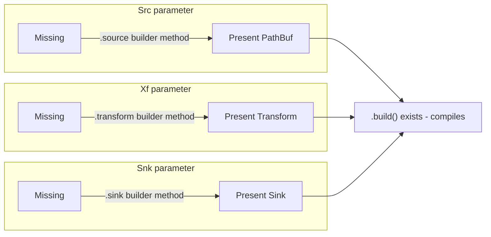

# Typestate pipeline builder

## Automatic contracts between typed stages

The new `typestate::contract_pipeline::ContractPipeline` carries the declared
output of a fallible Arrow source through any number of transforms to a sink.
Each transform declares the input it expects and the output it promises.
Attaching a transform or sink automatically enforces `ExactOrdered` against the
preceding output. A mismatch fails `cargo build` when the call is instantiated;
the caller writes no separate `CHECK`. Distinct Rust structs with the same
ordered shape are compatible. Renaming, reordering, casts and defaults are not
performed.

```rust,ignore
let pipeline = ContractPipeline::source::<Raw, _>(read_batches)
    .transform::<Raw, Clean>(clean_batch)
    .sink::<Clean>(write_batch)
    .build()?;
let report = pipeline.run()?;
```

`read_batches` is a factory returning a fallible iterator of `RecordBatch` values.
It opens once in `run`, after `build` has checked every declared Arrow mapping.
Each source batch and transform output is checked against its physical schema and
active required values before the next callback. An opaque callback may still
return an invalid batch or fail during execution. Errors carry the stage, input
batch index and original source. A later failure leaves earlier sink effects in
place; callers needing atomic publication must provide it at the sink boundary.
The builder reads one input batch at a time and does not collect the iterator.
Callback owned buffers and downstream engines have their own memory behavior.

The source is mandatory, a sink is terminal, and `build` is available only after
the sink. Zero or more transforms are allowed. `ExactOrdered` is the executor's
current policy; other declaration policies remain available through standalone
`contracts` checks. This API does not infer SQL or callback semantics, and it
does not change the legacy local and remote builders described below.

Run the [complete example](../../crates/typestate/examples/contract_pipeline.rs)
with `cargo run -p typestate --example contract_pipeline`. The
`contract_compilation` fixtures build compatible chains and require incompatible
connections to fail; `contract_pipeline` tests cover runtime validation and
failure behavior.

## SQL-stage transforms: `sql_transform`

`.transform()` takes a Rust closure. Anyone coming from Spark/Scala will
often reach for SQL instead of a closure for the same step - a `WHERE`, a
`GROUP BY`, a join - and `sql_transform` lets a stage do exactly that while
keeping the same compile-time check `.transform()` already runs:

```rust,ignore
let pipeline = ContractPipeline::source::<Raw, _>(read_batches)
    .sql_transform::<Filtered>(&ctx, "SELECT id, amount FROM batch WHERE amount > 50.00")
    .sink::<Filtered>(write_batch)
    .build()?;
```

Mechanically, each input batch is (re)registered on `ctx` as a table named
`batch` - the SQL string must query that name - then the query's result is
collected and concatenated back into the single batch `Filtered` is checked
against, the same `ExactOrdered` check a closure-based `.transform()` would
run on its own return value. A SQL stage isn't a weaker-checked escape
hatch; it's a different way to *produce* the batch, not a different way to
validate it.

One consequence of `ContractPipeline` staying synchronous end to end:
`sql_transform` drives DataFusion's `async` query API through a fresh
current-thread Tokio runtime built on every call, rather than a pooled or
reused one. That's the minimum viable bridge, not a performance choice -
making `ContractPipeline` itself `async` would ripple its signature into
every other stage, for one SQL-driven stage's benefit.

## The same stage, built from `DataFrame` calls instead of a SQL string: `dataframe_transform`

`sql_transform` above is the SQL-string path. `dataframe_transform` is its
sibling for callers who would rather chain DataFusion's own `DataFrame`
methods than build a query string:

```rust,ignore
let pipeline = ContractPipeline::source::<Raw, _>(read_batches)
    .dataframe_transform::<Filtered>(&ctx, |df| {
        df.filter(col("amount").gt(lit(50.0)))?
            .aggregate(vec![col("region")], vec![sum(col("amount")).alias("total")])
    })
    .sink::<Filtered>(write_batch)
    .build()?;
```

`build` receives the `batch` table already resolved as a `DataFrame` and
returns the chain applied to it. Internally this is *not* a second,
independently-written implementation next to `sql_transform` - both methods
share one private helper, `run_via_dataframe`, that does the
register-as-`MemTable` / spin-a-runtime / `collect` / `concat_batches`
ceremony exactly once. `sql_transform` calls it with `ctx.sql(sql)`;
`dataframe_transform` calls it with `ctx.table("batch")` followed by the
caller's closure. Writing that ceremony twice - once per transform flavor -
would have meant two places that could drift out of sync on exactly the kind
of operational detail (which table name, how the runtime is built, how the
result is concatenated back into one batch) that should only ever be decided
in one place. The same compile-time `ExactOrdered` check `.transform()` and
`sql_transform` already run still applies to the declared output type - a
`DataFrame`-built stage gets no weaker a guarantee than a SQL-built one.

**Scala bridge**: this is the same relationship Spark's `Dataset` API has to
Spark SQL - `df.filter(...).groupBy(...).agg(...)` and
`spark.sql("SELECT ... WHERE ... GROUP BY ...")` are two surfaces over the
same Catalyst plan, not two different execution engines. Reach for whichever
reads more clearly for a given stage; neither one is the "real" path.

### `scaffold-cli pipeline --transform-df`: the same chain, generated

Hand-writing the closure above is one option. `scaffold-cli pipeline` can
also generate it from a closed set of five named operations - `select`,
`filter`, `aggregate`, `sort`, `limit` - passed as repeated `--transform-df`
flags, one operation per flag, in the order they should run:

```bash
cargo run -p scaffold-cli -- pipeline \
  --source-schema parquet:fixtures/schema-gate-example/orders.parquet \
  --transform-df "filter:quantity,gt,0" \
  --transform-df "aggregate:group=region;sum(quantity)=total" \
  --sink-parquet /tmp/totals.parquet \
  --name OrderTotal
```

Each flag's text (`filter:quantity,gt,0`, `aggregate:group=region;sum(quantity)=total`,
and so on for `select:col1,col2` / `sort:col,asc;col2,desc` / `limit:N`) is
parsed exactly once, at the CLI boundary, into a `DfOp` value - nothing
downstream re-parses a string. `--transform-df` is mutually exclusive with
the pre-existing `--transform-sql` (passing both is a `CliError`); the
generated binary calls `dataframe_transform` with a closure built from the
parsed `DfOp` chain instead of a literal SQL string passed to `sql_transform`.

The five operations are deliberately a closed set, not a general expression
language. `filter`'s comparison, for instance, only understands
`eq|ne|gt|lt|ge|le` against one column and one literal - there's no attempt
to parse `(a AND b) OR c`-style boolean expressions. Anything past what these
five ops express already has an escape hatch: `--transform-sql` accepts
arbitrary SQL against the same `batch` table. Building a second, smaller SQL
parser just for `--transform-df` would duplicate that escape hatch instead of
earning its own reason to exist.

The generator itself (`schema-codegen`'s `struct_source`/`pipeline_source`,
and the new `dataframe_ops` renderer) builds the emitted Rust via `syn`'s
`quote!` macro - constructing a real token tree, then unparsing it with
`prettyplease` - rather than `format!`/`push_str`-ing text together by hand.
A malformed brace or identifier becomes impossible by construction instead
of something only the existing `trybuild` compile-and-run test would catch.
That compile-and-run test is still the thing actually proving correctness,
though: `quote!` only guarantees the generated *skeleton* parses as valid
Rust, not that the embedded column names or SQL make semantic sense - a typo
in a column name still only surfaces at the schema-on-write validation the
rest of this chapter already describes, or at `cargo build` if it breaks
`ExactOrdered`.

## A second guarantee: row-major and columnar batches can't be confused

Everything above uses typestate in the classic sense - a builder whose type
parameters track which stages are present. `pipeline::layout` proves the same
underlying idea - let the compiler reject an invalid state instead of checking
for it at runtime - works without any of that machinery, because Rust's own
nominal typing is already strict enough on its own.

The motivating gap: `transpose-cost.rs`, the benchmark that measures the cost
of converting an Arrow columnar batch to row-major layout and back (see
[the scale chapter](scale-and-parity.md) for the actual numbers), used to do
that conversion with two private free functions living inside the benchmark
itself. Nothing stopped a future caller - another benchmark, a real operator
- from reimplementing that same row<->columnar round trip a second time,
invisibly, inside its own body. The conversion was correct, but it wasn't
*named* anywhere a reader could see it happening.

`ColumnarBatch` and `RowBatch` fix that by being two plain structs:

```rust,ignore
pub struct ColumnarBatch { columns: Vec<Float64Array>, rows: usize }
pub struct RowBatch { buffer: Vec<f64>, rows: usize, cols: usize }
```

No phantom types, no generic marker parameter - a `ColumnarBatch` and a
`RowBatch` are already two unrelated types as far as `rustc` is concerned.
`ColumnarBatch::to_row_major(&self) -> RowBatch` and
`RowBatch::to_columnar(&self) -> ColumnarBatch` are the *only* functions
that cross between them. Try to pass a `&RowBatch` to something that wants
a `&ColumnarBatch` and the compiler rejects it before the program ever
runs - the same class of error as calling `.build()` on a builder missing a
stage, just enforced by two ordinary structs instead of a `Missing`/`Present`
marker pair. A dedicated `trybuild` test
(`crates/pipeline/tests/compile_fail/layout_type_mismatch.rs`) proves this is
real, not just a design claim: it asserts the exact `rustc` error -
`error[E0308]: mismatched types ... expected '&ColumnarBatch', found
'&RowBatch'` - for exactly that mistake.

**Scala bridge**: this is the same move Catalyst's SQL analyzer makes when it
resolves a column reference once, up front, instead of trusting every
downstream rule to check it again - a check that already exists gets
surfaced at one call site instead of being something every caller has to
remember to repeat. Here the "analyzer" is the Rust type checker itself, and
the surfacing costs nothing beyond naming two structs.

### Why `to_row_major`/`to_columnar` borrow instead of consume

Both conversions take `&self`, not `self`. An earlier design had them consume
the batch (`into_row_major(self) -> RowBatch`), which reads as the more
idiomatic Rust shape for a one-way conversion - but it would have forced
`transpose-cost.rs`'s own timed closure to `.clone()` the source columns on
every repeated run just to satisfy ownership, since the benchmark calls
`to_row_major` once per timed iteration and needs the original columns to
still be there for the next one. Cloning inside the loop being timed would
corrupt the exact measurement the benchmark exists to produce. Since the
conversion only reads column values and never needs to own them, borrowing
costs nothing and sidesteps the problem entirely.

### Construction also rejects a malformed batch up front

`try_new` on both types takes the row count (or row/column counts) as an
explicit argument rather than inferring it from the data, and checks it
immediately:

```rust,ignore
pub fn try_new(columns: Vec<Float64Array>, rows: usize) -> Result<Self, LayoutError>
```

A column shorter than the declared row count, or a row-major buffer whose
length isn't `rows * cols`, is a `LayoutError` at construction - never a
batch that silently disagrees with its own stated shape later. This is the
same "parse, don't validate" instinct as the typestate builder above:
catch the invalid state at the one place it's created, not at every place
it's later read.

## Existing local and remote builders

`crates/typestate` builds a pipeline (source → transform → sink) where an
incomplete pipeline fails to *compile*, not to *run*. There's no `unwrap()`
or `Result` check guarding against a missing stage - if you forget one,
`.build()` simply doesn't exist as a method, and rustc tells you so at the
call site.

## Why this instead of a runtime check

A conventional builder might look like this:

```rust,ignore
let pipeline = PipelineBuilder::new()
    .source(path)
    .sink(identity)
    .build()?; // returns Err("no transform set") at runtime
```

That bug - forgetting `.transform(...)` - only surfaces when the code
actually runs, possibly in production, possibly long after the builder was
written. The typestate pattern moves that check to compile time by giving
each required stage its own type parameter:

```rust,ignore
pub struct PipelineBuilder<Src, Xf, Snk> {
    source: Src,
    transform: Xf,
    sink: Snk,
}
```

`Src`, `Xf`, and `Snk` each start as a zero-sized `Missing` marker and
become `Present<T>` once you call the matching builder method. `.build()`
is only defined in the one `impl` block where all three parameters are
`Present<_>`:

```rust,ignore
impl PipelineBuilder<Present<PathBuf>, Present<Transform>, Present<Sink>> {
    pub fn build(self) -> Result<RecordBatch, pipeline::PipelineIoError> { .. }
}
```

Call `.build()` on any other combination and it's a plain "no method named
`build` found" compiler error - the same class of mistake as calling a
method that was never written, because as far as the type system is
concerned, it wasn't.

## Stages can be supplied in any order

Because `source`, `transform`, and `sink` are independent type parameters
(not one combined "pipeline state" enum), calling them in a different order
still narrows the right parameter:

```rust,ignore
PipelineBuilder::new()
    .transform(identity)
    .sink(identity)
    .source(path)   // order doesn't matter - each call narrows its own parameter
    .build()?;
```

## Why independent markers, not one combined state

A typestate builder in Scala often tracks its required stages as one
combined phantom state, narrowed monotonically as each stage is supplied.
Rust has no intersection types to combine three independently-satisfied
constraints into a single type parameter that way, so `PipelineBuilder<Src,
Xf, Snk>` keeps three separate parameters instead, each narrowed only by its
own setter. That isn't a workaround for a missing feature - it composes
better: calling `.source()`, `.transform()`, `.sink()` in any order still
narrows only the one parameter it touches, and `.build()`'s bound (all three
`Present<_>`) is what actually enforces completeness, rather than an enum
encoding one state per possible combination.



Three independent axes, each narrowed by its own setter in any order. `.build()`
is only defined in the corner where all three have reached `Present<_>` - miss
one and that corner of the type space simply has no `build` method.

## From free functions to real closures

The builder's `Transform`/`Sink` types started out as bare
`fn(RecordBatch) -> RecordBatch` pointers - free functions and noncapturing
closures could serve as stages, but a transform needing captured state (a
column name, say) couldn't be expressed at all. Widening both to
`Box<dyn Fn(RecordBatch) -> RecordBatch>`, and having `.transform()`/`.sink()`
accept `impl Fn(RecordBatch) -> RecordBatch + 'static` generically before
boxing internally, let capturing closures work alongside free functions. The
independence of the three type parameters paid off here too: broadening what
can fill `Xf` didn't require touching `Src` or `Snk` at all.

## Try it

```sh
cargo test -p typestate
```

This runs the happy-path tests plus a `trybuild` suite
(`crates/typestate/tests/compile_fail/`) that asserts `.build()` is a
compile error when any one stage is missing - proof that the guarantee is
real, not just documented.

## Configuration and callback boundaries

That boxed `Fn` design solved capturing, but still rejected a callback that
consumed a captured resource. The local `build` consumes the builder and calls
each callback once, so requiring repeatability bought no additional guarantee.
Local callbacks now use `Box<dyn FnOnce(RecordBatch) -> Result<RecordBatch, PipelineIoError>>`, and their
setters accept `FnOnce + 'static`. Remote transforms retain a separate repeatable
`Fn` alias because they run once per batch. These bounds do not add thread-sharing
requirements or imply schema validation.

The local `build` eagerly reads the CSV fixture, runs its two batch callbacks
and returns the batch. Its `sink` callback does not itself publish to storage.
The remote builder instead wraps the bounded pipeline and names an output
object. Stage presence alone establishes neither declaration compatibility nor
validation of external data.

The bounded pipeline previously accepted a zero batch size and asserted later;
the remote path could already have downloaded input before reaching that
assertion. `PipelineConfig.batch_size` now uses `NonZeroUsize`, and both pipeline
CLIs parse that type before execution. Zero and values above `usize::MAX` are
argument errors rather than a later pipeline panic. A custom configuration can
be constructed inside a function returning `Result`:

```rust,ignore
use std::num::NonZeroUsize;
use pipeline::bounded::PipelineConfig;

let config = PipelineConfig {
    batch_size: "250".parse::<NonZeroUsize>()?,
    channel_capacity: 0,
    ..PipelineConfig::default()
};
```

Defaults remain 1,000 rows per batch, capacity 4 and Snappy compression. Capacity
zero remains a valid rendezvous channel. A row-count bound is not a byte ceiling:
wide input rows, transformed batches and backend allocations still matter.

## Returning callback failures and checking results

Callbacks originally returned a batch directly. They could panic, but had no ordinary
return path for an expected failure. They now return `Result<RecordBatch, PipelineIoError>`.
An unchanged batch can be returned with `Ok(batch)`; a callback failure retains its original
error under a `Callback` error naming the stage and zero-based batch index.

The local builder validates the transform result before invoking the final callback, then
validates that callback's result before returning success. The bounded remote path validates
its transformed output before writing and digesting it. Both use the fixed ingest contract:
`id: Int64`, `name: Utf8`, nullable `note: Utf8`, in that order. Invalid output returns
`InvalidBatch`; stage completeness alone remains the narrower compiler guarantee.

Earlier, the local builder could return an arbitrary schema from a callback. It now
requires the fixed ingest schema after both callbacks. Schema-changing projections,
renames and aggregations that previously worked locally are therefore rejected.
This is an intentional restriction of this builder; the new typed pipeline above
supports declared schema-changing stages. The query APIs also support results
with different schemas.

A callback can still perform external actions or panic. A later error cannot undo those
actions, and the local final callback is not a transactional storage sink.
