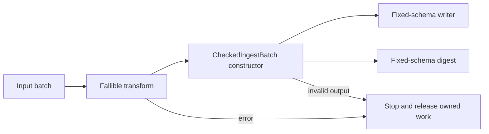

# 0016. Check runtime ingest batches before writing and digesting

## Status

Proposed - 20 October 2026. Acceptance depends on implementation review and verification.
This makes ADR 0015's fallible-transform and fixed-schema validation scope concrete.
It does not accept or complete ADR 0015's other design gates.

## Context

Declaration compatibility, complete builder configuration, and actual data validity are
different guarantees. The reviewed Datacrate baseline is
`9a53f7bcabce5e8e18ff8df52544f366babad8db`. Its declaration checks and nonzero
batch configuration have been repaired. Its bounded consumer still accepts an infallible
opaque callback, writes its result, then digests fixed column positions. A transform can
violate those assumptions; a complete typestate builder does not prevent that.

A typed wrapper establishes an invariant only when its constructor checks actual data.
Place that check at construction and keep the evidence private; a generic parameter
alone is not a semantic proof.

## Decision

Keep `contracts` independent of Arrow. Establish one explicit runtime contract inside
the existing `pipeline` crate for the current ingest dataset:

| Position | Name | Arrow type | Declared nullable | Actual null allowance |
| --- | --- | --- | --- | --- |
| 0 | id | Int64 | false | none |
| 1 | name | Utf8 | false | none |
| 2 | note | Utf8 | true | allowed |

Require exactly these fields, order, types, and nullability flags. Empty batches are valid.
Ignore schema/field metadata that the writer and digest do not interpret. Do not silently
cast dictionary strings, large strings, renamed columns, decimals, or timestamp units.
Those need separately specified mappings. This contract does not validate business rules.

Use a crate-private `CheckedIngestBatch` with private storage and
`try_new(batch: RecordBatch) -> Result<Self, PipelineIoError>`. It exposes an immutable
batch view, not mutable access, unchecked construction, or a replaceable public field.
The writer and digest consume the same checked output. Do not retain a witness across an
arbitrary transform; validate the returned batch. This witness describes this dataset only,
not an arbitrary `Contract::SHAPE`. The compiler-resolved/generic adapter gate remains open.
Expose `validate_ingest_batch(batch: &RecordBatch) -> Result<(), PipelineIoError>` for the
local builder in the separate typestate crate; the private constructor reuses that calculation.
This is a real second consumer, not a reason to expose the checked owner or invent a trait.

Make local callbacks `FnOnce(RecordBatch) -> Result<RecordBatch, PipelineIoError>`;
remote/bounded transforms remain repeatable `Fn` with that result. Migrate existing callers
explicitly with `Ok(batch)`, preserving local ownership and remote invocation cardinality.
Use a structured callback stage and batch index when wrapping the original error; preserve
the error source. Add typed batch violations for column count, field name/type/nullability,
and forbidden actual nulls. Do not replace them with a free-text error protocol.

The local builder checks the transform output before its final callback and checks the
returned final batch before exposing success. Its final callback remains an arbitrary action,
not a transactional storage sink: errors do not roll back external effects. The bounded path
checks after each transform and before both fixed-schema consumers.

Prefer this wrapper over two separate writer/digest validation passes because it shares
the invariant without duplicating schema knowledge. A generic typed pipeline or generated
Arrow adapter would add unsupported schema and coherence decisions. A bare validation
function is sufficient only if there is one immediate consumer and no reused evidence.

### Acceptance

- Reject wrong count/order/name/type/declared nullability through a normal error path.
  Reject forbidden array nulls when constructible through safe Arrow APIs; record the
  construction precondition if Arrow itself rejects a malformed case earlier.
- Verify invalid output never reaches writer write or digest access. Test valid output,
  empty output, nullable notes, and callback errors with original source/stage/index.
- With a producer blocked by a full or rendezvous channel, consumer failure must terminate
  the producer after receiver closure. Tests coordinate with barriers, not hopeful sleeps.
- Keep incomplete/duplicate/consumed-builder compile-fail fixtures and consuming-capture tests.
  Preserve persisted digest results and batch-boundary parity.
- Test local and remote wiring separately; this does not turn arbitrary callback panics into
  recoverable errors or interrupt callbacks that never return.

## Consequences

A runtime check and a small owned witness replace undocumented writer/digest assumptions.
Field/schema checks add bounded per-batch work; null counting must use Arrow's batch metadata
rather than scalar probing. This deliberately narrows accepted transform outputs to the
declared fixed schema. Callback signatures are a source API migration in unpublished crates.

The pure validator owns schema decisions; execution owns callbacks, I/O, and cancellation.
No new crate, unsafe code, reflection, broad builder hierarchy, or engine dependency enters
`contracts`. Book examples must explain the earlier unchecked boundary and why it changed.

## Sources

- [Datacrate consumer](../../crates/pipeline/src/bounded.rs),
  [digest](../../crates/pipeline/src/manifest.rs), [builders](../../crates/typestate/src/lib.rs)
- [ADR 0015](0015-strengthen-contract-and-pipeline-boundaries-from-rust-trait-and-const-design.md)
